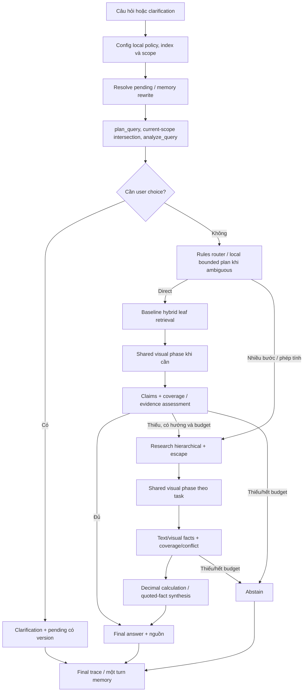

# Kiến trúc hệ thống RAG local tự định tuyến

Ngày: 03/10/2026. Mô tả code sau UPDATE_IMPLEMENTATION_PLAN; [báo cáo implementation](rag_architecture/UPDATE_IMPLEMENTATION_REPORT.md) ghi test/demo và giới hạn đo đạc. [CHANGE_REPORT](CHANGE_REPORT.md) là lịch sử hierarchical trước cập nhật, không phải contract hiện tại.

## Trách nhiệm module

```text
denso_a3/
  contracts.py                    shared records/config/errors
  bt1..bt3/                       ingestion, OCR, layout/table extraction
  bt4/chunking.py metadata.py hierarchy.py
  bt5/store.py hierarchy_store.py  leaf/node SQLite + Qdrant access
  bt6/planner.py                  normalized query + verified scope
      question_analysis.py        requirements/features, no model I/O
      query_router.py             rules/local planner routing
      task_planner.py             validated T/C/U research plan
      question_conditions.py      user literal spans/provenance
      retrieval.py hierarchical_retrieval.py
      evidence_assessment.py evidence_coverage.py conflicts.py
  bt7/visual_evidence.py           shared source/crop/observation phase
      fact_extraction.py          text/visual facts validation
      calculation.py              Decimal/unit arithmetic
      answering.py memory.py      grounded rendering/pending storage
  backends/generation.py rag_models.py  local model adapters/lifecycle
  pipeline/rag_runner.py          dispatcher, scope/memory/finalization
           baseline_runner.py research_runner.py query_budget.py
           index_builder.py rag_cli.py rag_config.py
  ui/app.py                       user scope/memory/citations
  evaluation/                     draft and reviewed metrics
```

UI không chứa router/business rules. BT6 tìm/định tuyến/kiểm tra requirements; BT7 evidence/answer/calculation. Contracts shared đặt trong contracts.py, orchestration tách adapters/readers/CLI.

## Build và query

Build dùng extraction artifacts đã hoàn tất, metadata/chunks/parent context, optional visual captions rồi document/page hierarchy, embeddings và stores. Output mới dựng staging; chỉ manifest ready được query. Hierarchy schema 1.1 thêm document/page records/routing vectors, giữ leaf sources. Upgrade không OCR/re-embed leaf và không sửa snapshot nguồn.



Các stage model chạy tuần tự; sơ đồ không khẳng định chạy song song. VLM là shared evidence phase sau route/retrieval; cả hai runners gọi cùng hàm, text đủ thì skip. Hierarchical escape chạy trong mỗi task, không chỉ fallback routing failure; routed + escape nối/loại trùng/table expansion, không joint rerank toàn bộ sau merge.

## Public API và dữ liệu

```python
ask(index=index, question=question, config=config, strategy=None,
    filters=None, conversation_id=None, memory_path=None,
    pending=None, progress=None)
```

Dùng keyword arguments. Bỏ assumptions parameter; config research_assumptions/CLI --assumptions cũ báo migration. `ask` trả dict AnswerRecord: question/answer/status/language, citations/evidence/conflicts, trace/timings_ms/usage. Config/model/runtime/schema error được báo rõ. answered/abstain/clarification/conflict không là xác suất đúng.

| Contract | Vai trò |
|---|---|
| QueryPlan | Canonical hybrid/visual policy + hard scope + search question |
| QueryAnalysis | Requirements có wording; calculation/dependency/comparison/visual/clarification signals |
| RouteDecision | Baseline/hierarchical, source/reason/capability, optional validated plan reused |
| EvidenceAssessment | Sufficient/missing/requires_research/clarification/conflict, missing requirements, support/errors |
| QueryBudget | Monotonic deadline, counters/usage và request visual cache xuyên attempts |
| QuestionCondition | U ID + literal user-question/clarification span, applies_to, normalized value/unit |
| VisualEvidence/Observation | Code-selected source asset/hash/crop + literal observed/unreadable/ambiguous reading |
| EvidenceFact | Text quote/literal hoặc source_visual support_text + image/observation provenance |

Document facts có chunk/source citations; user conditions riêng condition_ids. Không tạo chunk fact giả cho scenario numeric. BAT missing transfer relationship không suy từ hoàn thành 100% mục tiêu; tìm source, clarification hoặc abstain. Calculator kiểm T/C/U IDs/DAG/types, Decimal dimensions/currency/periods và division; không eval/literal tùy ý.

Geometry là normalized canonical-page `[x0,y0,x1,y1]`, gốc trái trên; PDF page bắt đầu 1, ảnh là null. Crop citations giữ source bbox. Assets/crops chọn từ allowed scope với real SHA; model không được đề xuất đường dẫn ảnh. Partial-page scope không gửi pixels ngoài scope. Observations validation xác lập provenance/format, vẫn cần review ảnh để đánh giá đúng ngữ nghĩa/pixel.

## Scope, local-only và lifecycle

Local policy trước rewrite/router/planner/generation; UI ép auto/hybrid/visual auto/local_only bằng replace. Loopback llama-server/session local không dùng proxy môi trường; local error không cloud fallback. API adapter legacy còn trong code nhưng UI không cho tắt local-only; auto provider API bị chặn.

Hard source/document/page/kind/verified metadata scope giữ ở cả baseline/hierarchy/escape/parent/crop/citations. Current/revision lọc giao với scope hiện có, không overwrite để mở rộng. Synopsis/caption hỗ trợ tìm, không thành fact. Conflict/runtime/user choice/budget không đổi route để vượt gate; escalation baseline→research tối đa một, research không quay lại baseline.

QueryBudget mặc định 300 giây, 12 logical retrieval calls tổng, 1 escalation, 2 router attempts và 6 visual calls gồm repair; mỗi visual call tối đa 2 ảnh. Research giữ tasks 6/rounds 3 và stage ceiling không renew deadline. Context research 4.500 tokens phải vừa prompts/answer trong context config; required evidence không cắt âm thầm. Logical task retrieval chứa nhiều backend searches, trace ghi chi phí riêng.

Embedding/rerank/generation nạp/đóng tuần tự để hạn chế VRAM; vector task reuse trong routed/escape. Cache visual request-local theo source/crop/task/scope/model; chưa có pooling toàn model hoặc steady-state inference guarantee. Qdrant local chỉ một process mở cùng index.

## UI, memory, trace và migration

UI có question/scope/memory/advanced filters/upload/metadata/citations; không mode/strategy/assumptions widgets và không đọc BAT file. UI result/pending hash gồm actual content files/config/filters/memory. Pending schema 2.0 có original_question/clarification_question/scope/index/config fingerprints; old assumptions/version hoặc changed scope/content/config bị invalidated, history giữ nguyên.

Long-term turns/pending ở SQLite .local/conversations.sqlite; instant RAM. Memory chỉ hiểu tham chiếu. Dispatcher giữ một turn final kể cả escalation. Trace routing có initial_route/final_route/method/reason_codes/needs_visual/plan_reused/capability/escalations; attempts giữ status/sources/stage traces/timings/usage; budget giữ counters/elapsed/remaining/stop_reason, visual phases giữ source regions/observations/cache. Không log hidden reasoning.

Production index chọn snapshot hierarchy ready hiện có hoặc rag-upgrade sang output mới. Không mutate legacy manifests, xóa snapshots/history hoặc tháo Qdrant lock bằng xóa dữ liệu. Forced baseline/hierarchical dùng CLI/config cho debug/A-B/C.

## Kiểm chứng và giới hạn

Unit/scripted/AppTest kiểm scope/pending/claims/conditions/units/visual contracts; model-real demo là lớp bằng chứng khác. Evaluators giữ config mode, đọc reviewed gold chỉ trong scoring, báo routing/latency/tokens/counters/status/evidence/calculations; substring/citation pointer proxies ghi riêng. Semantic answer/visual reading correctness cần soát ảnh/nguồn.

Chưa có benchmark A/B/C human-reviewed toàn corpus đủ để tuyên bố speed/accuracy tốt hơn baseline, confidence 99%, peak VRAM hoặc SLA. Coverage chỉ đủ plan model đã tạo; quote/source pointer hợp lệ chưa chứng minh mọi claim đúng. Xem [demo/code flow](DEMO_CODE_FLOW.md), [so sánh](ARCHITECTURE_COMPARISON.md) và [báo cáo](rag_architecture/UPDATE_IMPLEMENTATION_REPORT.md).
