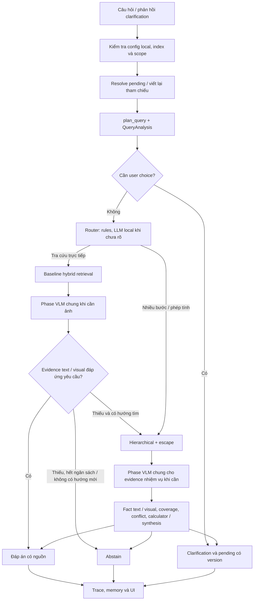

# Plan cập nhật RAG: tự định tuyến, UI đơn giản và bỏ giả định mặc định

Ngày plan: 03/10/2026. Cập nhật trạng thái 04/10/2026: **F1–F8 đã triển khai và có regression/demo local**, xem [báo cáo implementation](UPDATE_IMPLEMENTATION_REPORT.md). Nội dung thực trạng mục 1 là baseline trước update. Benchmark human-reviewed toàn corpus/holdout chưa có; không coi các ca demo nhỏ là chứng nhận hiệu năng/accuracy rollout.

Tài liệu này là checklist triển khai cho các quyết định đã chốt: router local chọn baseline/hierarchical, bỏ lựa chọn kỹ thuật trên UI, bỏ cơ chế truyền giả định JSON, giữ hybrid, tách VLM thành phase local dùng chung sau định tuyến, giới hạn tìm bổ sung và ghi trace định tuyến. Khi implement, đối chiếu lại code nếu trạng thái repo đã thay đổi.

## 1. Thực trạng dự án trước khi cập nhật

### 1.1. Chức năng đã có và phần còn thiếu

| Thành phần | Thực trạng đã đối chiếu | Việc cần làm |
|---|---|---|
| Điều phối | `ask()` dispatch theo `config.orchestration_mode`; mặc định dataclass là `baseline` | Thêm `auto` và router; giữ hai luồng làm implementation nội bộ |
| Planner quy tắc | `plan_query()` nhận intent bằng regex, scope và metadata | Tái sử dụng; chưa coi nó là bộ phân loại độ phức tạp hoàn chỉnh |
| Planner research | LLM local tạo tasks/dependencies/calculations sau khi đã chọn hierarchical | Dùng khi cần và cho phép reuse plan từ router |
| Router độ phức tạp | Chưa có | Thêm quy tắc → LLM local cho câu chưa rõ → quyết định có thể nâng cấp theo evidence |
| Retrieval | Đã có lexical/dense/hybrid/auto/visual; hybrid và auto đều ghép keyword + semantic | Chuẩn hóa hybrid mặc định, tách visual policy khỏi strategy |
| Baseline | Một lượt leaf retrieval, conflict gate, LLM/VLM trả lời và citation | Tách thành runner có thể gọi lại; thêm đánh giá thiếu evidence và escalation hữu hạn |
| Hierarchical | Document → page → leaf, task ledger, quote/value/unit validation, coverage, calculator | Tái sử dụng; nhận plan/budget do dispatcher cung cấp |
| Escape | Gọi thêm leaf retrieval toàn scope trong mỗi query task; không phải fallback chỉ khi routing thất bại | Giữ hành vi này trong bản cập nhật; ghi rõ chi phí và counters |
| Gộp routed/escape | Nối routed trước escape, loại trùng `chunk_id`, mở rộng bảng; chưa rerank chung sau gộp | Giữ; không quảng bá thành rerank toàn bộ mới |
| Đọc ảnh | Baseline đính kèm tối đa hai ảnh cho VLM trong bước answering | Tách thành phase visual evidence dùng chung sau khi router đã chọn kiến trúc |
| Research với ảnh | Fact extractor dùng text/table; loại `page_visual`; chưa xác minh fact trực tiếp bằng ảnh | Bổ sung nguồn fact visual từ phase chung; caption chưa qua phase không là fact |
| UI | Có chọn luồng và strategy; ô hard filters; ô giả định BAT | Bỏ chọn luồng/strategy/giả định; giữ scope, memory, citation và filters nâng cao |
| Giả định | UI đọc `bat.assumptions.json`; truyền qua `ask`, research planner/runner, pending, renderer và evaluator | Loại toàn đường truyền; sửa fixtures/tests/docs liên quan |
| Planner BAT | Có recipe gross-margin và hướng dẫn gắn với full-transfer assumption | Bỏ suy diễn mặc định; thiếu quan hệ nghiệp vụ phải tìm nguồn hoặc làm rõ |
| Provider | Config local dùng Qwen GGUF qua llama.cpp loopback; hierarchical từ chối provider API | Router và auto path phải local-only, kiểm tra trước mọi model call |
| API adapter | Baseline có adapter API, mặc định tắt | Giữ adapter để tương thích code cũ; sản phẩm local chặn provider API ở đường hỏi đáp mới |
| Memory | Instant RAM; long-term SQLite; pending hiện gắn với mode hierarchical và assumptions | Pending theo scope/version, độc lập mode UI; không tiếp tục facts cũ như nguồn |
| Resource lifecycle | Weights reload; embedding/rerank/generation tuần tự, vector reuse trong một query task | Bảo toàn vòng đời và reuse plan; chưa cam kết pooling toàn model |
| Benchmark | Có evaluator và tests; draft substring/citation pointer chỉ là proxy | Thêm đánh giá router/A-B trên nhãn đã soát, không suy độ đúng từ proxy |

### 1.2. Cấu hình và snapshot hiện có

- [`configs/rag.local.json`](../../../configs/rag.local.json) đặt provider local, chưa đặt mode nên kế thừa baseline.
- [`configs/rag.hierarchical.json`](../../../configs/rag.hierarchical.json) đặt local + hierarchical, 6 tasks, 3 rounds, 12 retrieval calls logic, deadline research 300 giây, evidence context 4.500 tokens.
- Trạng thái **lưu trên đĩa** trong `.local/workspace.json` trỏ tới `.local/indexes/59f1648f8fd3`: schema `1.0`, 1.217 chunks, chưa có `hierarchy_version`. Đây không phải khẳng định trạng thái tab UI đang mở.
- Snapshot `.local/indexes/hierarchical_20261003` đã ready: schema `1.1`, hierarchy `1.0`, 173 nodes gồm 53 document + 120 page, 1.217 chunks.
- Index cũ có thể upgrade thành snapshot mới, không OCR lại/re-embed leaf. Không sửa trực tiếp snapshot nguồn hoặc tự mở khóa Qdrant bằng xóa dữ liệu.
- Tests hiện có trong [`test_rag.py`](../../../tests/test_rag.py), [`test_hierarchical.py`](../../../tests/test_hierarchical.py), [`test_pipeline.py`](../../../tests/test_pipeline.py). Việc lập plan này không chạy lại tests/model và không xác nhận chúng đang pass.

### 1.3. Các giới hạn cần giữ đúng trong mô tả sản phẩm

Hierarchical + escape chưa bảo đảm nhanh hơn baseline. Coverage chỉ kiểm tra đủ task trong kế hoạch; quote/citation hợp lệ chưa chứng minh ngữ nghĩa đáp án đúng. Không có confidence được hiệu chỉnh. Chưa có benchmark A/B toàn corpus đủ để kết luận luồng mới vượt baseline.

## 2. Phạm vi và quyết định triển khai

| ID | Thay đổi đã chốt | Kết quả cần đạt |
|---|---|---|
| F1 | Router local | Tự chọn baseline/hierarchical theo công việc cần làm |
| F2 | UI không chọn kiến trúc | Người dùng nhập câu hỏi, chọn scope và memory; không cần hiểu thuật ngữ retrieval |
| F3 | Bỏ giả định JSON | Không ô giả định, không default BAT, không lén lấy assumptions từ config/pending cũ |
| F4 | Hybrid mặc định | Keyword + semantic vẫn chạy nội bộ; legacy `auto` giữ được visual behavior |
| F5 | VLM local là phase chung | Sau chọn kiến trúc, cả baseline và hierarchical gọi cùng phase khi cần đọc ảnh; VLM không là route thứ ba |
| F6 | Escalation hữu hạn | Baseline có thể nâng sang research khi thiếu đầu vào; không lặp vô hạn hoặc tự nới scope |
| F7 | Trace router | Có route, lý do, capability, escalation, budget và timings |
| F8 | Dữ kiện có nguồn | Thiếu căn cứ/điều kiện thì tìm tiếp, clarification hoặc abstain; không tự bịa assumptions |

Không xóa baseline khỏi code, không huấn luyện classifier mới, không đổi OCR/index schema chỉ để thêm router. Không thêm cloud fallback. Bản cập nhật phải tách xử lý ảnh hiện có khỏi baseline và bổ sung visual evidence/fact cho research; không coi chỉ bật ảnh lúc synthesis là đã hoàn tất phase chung.

## 3. Luồng đích và thứ tự xử lý



Thứ tự bắt buộc:

1. Kiểm tra policy local-only **trước** memory rewrite/router/planner/generation.
2. Resolve scope và pending; nhận câu gốc + clarification hợp lệ. Conversation chỉ giúp hiểu tham chiếu.
3. Chuẩn hóa query, verified metadata và current/revision scope ở một helper chung; cả hai runner nhận cùng scope bất biến.
4. Router phân loại sơ bộ; ambiguity về user choice trả clarification, không coi là research phức tạp.
5. Thực thi retrieval của route, gọi phase VLM chung khi cần nguồn ảnh rồi đánh giá evidence; chỉ escalation baseline → hierarchical tối đa một lần.
6. Chọn trạng thái cuối, giữ citations/trace từ mọi attempt, lưu một turn cho toàn câu hỏi rồi đóng tài nguyên.

Conflict/config/runtime lỗi không tự kích hoạt đổi route để tìm một đáp án thuận lợi hơn. Research thiếu nguồn không được quay lại baseline để vượt fact gate.

## 4. Contracts mới và API đích

Các contracts dùng chung đặt trong [`contracts.py`](../../../denso_a3/contracts.py). Tên dưới đây là tên đề xuất để implement; không phải API đã tồn tại.

### 4.1. QueryAnalysis và RouteDecision

`QueryAnalysis`:

- `question`, `search_question`, `language`.
- `requirements`: các yêu cầu có ID, label, entity/attribute và đoạn wording trong câu hỏi hỗ trợ yêu cầu.
- `needs_calculation`, `needs_dependency`, `needs_comparison`, `needs_visual`, `needs_clarification`.
- `rule_hits` và `ambiguous`: tín hiệu chẩn đoán; không dùng độ dài câu làm tiêu chí duy nhất.

`RouteDecision`:

- `route`: `baseline` hoặc `hierarchical`.
- `source`: `rules`, `local_llm`, `manual_debug` hoặc `evidence_escalation`.
- `reason_codes`, `reason`: giải thích ngắn, không lưu hidden chain-of-thought.
- `needs_visual`, `capability_check`, `planner_reused`.
- `research_plan`: optional, chỉ nhận plan đã qua validator để tránh gọi planner lại.

Clarification/abstain/error là kết quả xử lý ngoài router, không thêm luồng giả thứ ba vào enum route. Không có trường confidence 98/99% để gate khi chưa được hiệu chỉnh.

### 4.2. EvidenceAssessment

Gồm `state = sufficient | missing | requires_research | clarification | conflict`, các `requirement_ids` còn thiếu, nguồn/quote hỗ trợ, `needs_visual`, `next_action`, `reason_codes` và `validation_errors`.

`sufficient` nghĩa là kiểm tra hiện có thấy đủ hỗ trợ cho yêu cầu, không phải xác suất đúng. Assessment không được tự tạo hard filters hoặc values thay cho evidence.

### 4.3. QueryBudget

Đối tượng request-local dùng monotonic clock và đếm tổng retrieval calls logic, router/planner calls, generation attempts, escalation và deadline. Một budget dùng xuyên memory rewrite → routing → baseline → research; escalation không cấp lại deadline/calls mới.

### 4.4. QuestionCondition và pending

`QuestionCondition` thay cho dict assumptions ngoài câu hỏi, chỉ khi câu hỏi/clarification nêu điều kiện rõ: `condition_id`, `kind`, `raw_text`, `start/end`, `origin = user_question | user_clarification`, normalized value/unit nếu hỗ trợ. Span offset theo chuỗi question/clarification lưu kèm; validator kiểm tra raw text thực sự nằm trong đó.

Thêm `applies_to` để giữ điều kiện áp vào entity/quan hệ nào. Nếu literal lặp hoặc ý nghĩa không rõ, hỏi làm rõ thay vì gán nhầm. Tỷ lệ phần trăm rõ ràng có thể được code normalize thành ratio dimensionless bằng chia 100, giữ literal và conversion trace; không tự coi mọi “100%” là cùng một tỷ lệ nghiệp vụ.

Đây là input kịch bản có provenance, không phải document fact. Không tự diễn giải “hoàn thành 100% mục tiêu” thành “100% chuyển thành doanh số”. Conditions không được lấy từ tên file, demo config hay answer cũ.

Pending version mới chứa `schema_version`, `original_question`, `clarification_question`, `scope_fingerprint`, index/content fingerprint, condition spans và route hint. Không chứa dict assumptions hoặc facts được tin lại.

### 4.5. Các hàm và trách nhiệm

| Hàm đích | Input → output | Ghi chú |
|---|---|---|
| `analyze_query(question, query_plan)` | Câu chuẩn hóa → QueryAnalysis | Rules, không model I/O |
| `validate_question_conditions(question, clarification, candidates)` | Literal condition candidates → conditions có spans/units/provenance | Code resolve unique spans và normalize; ambiguous hoặc unsupported bị từ chối |
| `route_question(analysis, capabilities, config, generator, budget)` | Analysis → RouteDecision | LLM local chỉ khi chưa rõ; plan hợp lệ có thể reuse |
| `assess_evidence(analysis, evidence, visual_result=None, generated_coverage=None)` | Yêu cầu + nguồn + coverage → EvidenceAssessment | Rules/validation; coverage LLM nằm trong call generation, không checker call riêng |
| `run_baseline(root, question, plan, config, manifest, generator, analysis, budget)` | Query/scope → attempt result + assessment | Retrieval → shared visual phase → answering; không tự ghi memory/dispatch research |
| `run_research(..., research_plan=None, question_conditions=None, budget=None, progress=None)` | Query/plan → AnswerRecord | Reuse plan, budget chung; không assumptions/pending logic của UI |
| `ask(..., strategy=None, ..., pending=None, progress=None)` | Request → AnswerRecord | Dispatcher, local policy, memory, final trace; bỏ `assumptions` parameter |

Dùng keyword arguments cho `ask()` sau đổi signature để tránh positional arguments lệch vào `pending/progress`. Các caller nội bộ, evaluator và tests phải được sửa cùng đợt.

### 4.6. VisualEvidence, VisualObservation và EvidenceFact

`VisualEvidence` trỏ tới ảnh thật đã chọn từ scope: `image_id`, `image_sha256`, `image_asset`, `document_id`, `page_id`, `page_number`, `source_relative`, allowed `chunk_ids` và `source_bbox`. Không nhận đường dẫn/ảnh do model tự đề xuất.

`VisualObservation` gồm `observation_id`, `image_id`, `requirement_id/task_id`, `state = observed | unreadable | ambiguous`, `observed_text`, `raw_value`, `unit_text`, entity/row/column labels và provenance. Không dùng confidence model tự khai để kết luận observed là đúng.

Mở rộng `EvidenceFact` với `support_kind = text | image`, origin `source_rule | source_text | source_visual`, `visual_observation_id`, `image_id` và `support_text`. Fact text giữ quote/literal validation như cũ; fact image không giả có quote OCR substring. `source_visual` chỉ được tạo từ observation qua visual validator và parse-unit checks; không từ caption của index.

`quote` vẫn phục vụ fact text; visual dùng `support_text/observed_text` với origin rõ. Synthesis/renderer phải đọc đúng loại support, không truy cập quote text như thể mọi fact đều là OCR. Các fields image được để null ở fact text để giữ compatibility.

Research plan schema mới giữ `tasks`, `calculations`, `clarification`, bổ sung `question_conditions` đã validate và metadata analysis cần router. LLM đề xuất literal candidates; code xác định/kiểm tra spans trước công bố plan. `validate_research_plan()` phải kiểm tra IDs T/C/U, dependency DAG và provenance U; calculator chỉ nhận plan đã validate. Không chuyển điều kiện text bất kỳ thành hệ số numeric.

`run_visual_phase(root, query_plan, evidence, config, manifest, generator, budget, requirements, task=None)` là hàm dùng chung ở `bt7/visual_evidence.py`. Trả `VisualPhaseResult` chứa selected images, observations validated, missing/ambiguous, usage và trace. Chỉ visual phase gọi generation với images trong đường hỏi đáp mới; answering cuối nhận text facts/observations và source pointers, không nhúng lại ảnh theo branch baseline.

Baseline generation schema có `status`, `claims` và `coverage`; mỗi claim dùng source IDs, mỗi coverage item dùng requirement ID + state + support refs. Code render `answer`/`citations` ra `AnswerRecord` như contract public hiện có. Visual refs trỏ tới observation và ảnh nguồn; text refs trỏ quote/context được cấp. Không lưu hai bản answer không đồng nhất từ claims và text model tự viết.

## 5. Chính sách định tuyến cụ thể

### 5.1. Rules trước, LLM chỉ cho trường hợp chưa rõ

| Tín hiệu | Route ban đầu |
|---|---|
| Một entity, tra một thông số/định nghĩa trực tiếp | Baseline |
| Liệt kê một vài thuộc tính của cùng entity, không dependency/phép tính | Baseline probe; kiểm tra đủ requirements |
| Phép tính với nhiều dữ kiện tài liệu | Hierarchical |
| So sánh nhiều entity/version cần thu đủ input | Hierarchical |
| Cần tìm tên/mã/nhà sản xuất rồi dùng để tìm tiếp | Hierarchical |
| Nhu cầu đọc ảnh đơn giản | Baseline + visual required |
| Scope/entity/đơn vị cần người dùng chọn | Clarification trước route execution |
| Rules chưa rõ, câu tổng hợp/suy luận khó xác định | Gọi LLM local tạo plan bounded, validate rồi chọn route |

LLM bước chưa rõ dùng schema planner chung, trả task/dependency/calculation và metadata analysis. Một task trực tiếp, không arithmetic/dependency/comparison → baseline; nhiều bước thật sự → hierarchical. Nếu dùng research plan để quyết định route thì chuyển plan đó vào runner, không lập lại cùng kế hoạch.

Một câu dài không tự thành complex; một câu ngắn vẫn có thể là dependency query. Số tasks chỉ là tín hiệu, không được thay thế ý nghĩa yêu cầu. Rules và prompt phải hoạt động với Việt/Anh, identifier và tham chiếu đã rewrite.

Output LLM sai schema được sửa tối đa một lần trong budget. Tiếp tục sai: trả lỗi planner/router rõ ràng; không dùng raw output để gọi model khác hoặc gán confidence cao.

### 5.2. Capability và mixed visual

- Route research yêu cầu hierarchy capability. Index legacy vẫn cho baseline simple chạy; query cần research trên index chưa upgrade trả abstain với `capability_missing` và hướng dẫn chuẩn bị kho ở phần quản trị/chi tiết. Không tự đổi sang baseline và giả đã đáp ứng complex query.
- Khi triển khai lên workspace hiện tại, chuẩn bị/chọn snapshot hierarchy trước khi bật auto mặc định. Không build/upgrade toàn kho trong mỗi query.
- `needs_visual` độc lập route. Sau route và retrieval, shared VLM phase được gọi khi câu yêu cầu xem ảnh, evidence có visual/figure hoặc OCR/table có dấu hiệu thiếu thông tin cần thiết. Không ép chạy VLM cho mọi câu text đủ nguồn.
- Complex + visual: hierarchical gọi cùng phase cho evidence của task; visual observations hợp lệ có thể thành facts và vào coverage/calculator. Ảnh unreadable/ambiguous hoặc thiếu nguồn thì tìm bổ sung trong budget, clarification hoặc abstain; không caption-as-fact hoặc bypass calculator/coverage bằng baseline.
- VLM không tự chọn kiến trúc, không thay router và không tạo route thứ ba. Hai boxes VB/VH trong sơ đồ là cùng một hàm/phase dùng chung, được gọi ở thời điểm phù hợp của từng runner.

## 6. Hybrid và UI đích

### 6.1. Chuẩn hóa strategy và visual policy

Thêm `retrieval_strategy = hybrid` và `visual_policy = auto | required | off` vào config/contract. Strategy quyết định keyword/semantic; visual policy quyết định eligible image candidates và có gửi ảnh lúc generation không.

Normal UI luôn dùng hybrid + visual auto. `visual_policy=auto` phải cho phép page_visual như legacy strategy auto và bật gửi ảnh khi query yêu cầu hoặc evidence top đầu có visual/figure. Không đổi đơn giản `strategy='auto'` thành `'hybrid'` rồi vô tình loại ảnh.

Giữ CLI/debug alias: legacy `auto` → hybrid + visual auto; `visual` → hybrid + visual required; lexical/dense chỉ để thử nghiệm. Ghi `requested_strategy` và `effective_strategy` trong trace. Retrieval trace phải thể hiện đúng nhánh thực sự chạy.

### 6.2. Thay đổi UI

- Bỏ selectbox “Luồng xử lý”, selectbox “Kiến trúc” và ô “Giả định người dùng JSON”.
- Bỏ việc load `bat.assumptions.json` khi mở UI, parse assumptions và so sánh assumptions/mode trong cache kết quả.
- UI dùng `dataclasses.replace` để cố định mode auto, local_only=true, strategy hybrid và visual policy auto; không mutate config dùng lại giữa câu hỏi hoặc cho file config cũ vô tình bật API.
- Giữ câu hỏi, chọn nguồn, memory, metadata và Hard filters JSON trong phần nâng cao; đổi tên expander thành “Nâng cao”.
- Giữ citation/ảnh, coverage và thông báo hỏi làm rõ. Lý do route/counters ở “Chi tiết xử lý”; người dùng thường không phải lựa chọn thuật toán.
- Session pending được truyền theo scope/version, không phụ thuộc mode UI. Cache `last_answer` gắn scope + config/policy fingerprint; đổi index/filters/config thì không hiển thị như kết quả của request mới.

### 6.3. Phase VLM dùng chung sau định tuyến — quyết định người dùng đã xác nhận

Trật tự cho baseline: `route baseline → hybrid retrieval → visual phase khi cần → assessment/answering text + visual support → final`.

Trật tự cho hierarchical: `route hierarchical → task plan → retrieval task (routed + escape) → visual phase khi cần → extract/validate text hoặc visual fact → coverage → calculator/synthesis`.

Router có thể đặt needs_visual trước, nhưng ảnh nguồn chỉ được chọn sau retrieval/scope resolution. Visual phase không xử lý toàn kho trước router. Sau mỗi batch retrieval, chạy VLM rồi fact extraction theo lifecycle tuần tự; đóng embedding/reranker trước khi nạp VLM.

Các bước trong `run_visual_phase()`:

1. Xác định cần ảnh từ query requirements, visual hits hoặc cờ OCR/table thiếu. Nếu không cần, trả `skipped` trong trace, không nạp model.
2. Chọn tối đa hai ảnh mỗi call từ evidence/page có thật trong allowed scope. Nếu chỉ một số leaf trong trang được phép, chỉ gửi crop tương ứng; không gửi toàn trang chứa phần ngoài scope. Không có vùng hợp lệ thì báo thiếu evidence.
3. Caption chỉ giúp tìm ảnh; ảnh gốc/crop thật mới được gửi VLM. Source IDs/page/bbox do code cấp trước, không tin ID/path/bbox mới do model bịa.
4. VLM local trả observations theo schema, raw literal + row/column/entity labels, hoặc unreadable/ambiguous. Không yêu cầu model đoán số mờ, tính toán, sửa dữ liệu, hay dùng kiến thức ngoài ảnh.
5. Validate source IDs, observed-state fields, units/literal parse và task match. Fact image đi qua validator riêng; không áp text-quote substring validation lên nội dung pixel.
6. Kết quả có provenance để hai runner sử dụng. Nếu text/OCR và visual đọc khác nhau cho cùng trường/ngữ cảnh, đánh dấu conflict/ambiguity; không tự ưu tiên một số cho vừa đáp án.
7. Trace ghi ảnh/vùng thực sự đã gửi, observations, validation errors, model calls và usage; kết quả chưa được người soát phải mang quality flag rõ.

`source_bbox` lấy từ vị trí source/crop hợp lệ và giữ tọa độ normalized trên ảnh canonical. Nếu chỉ xác định được cả trang, citation phải nói độ chính xác là page-level; không tự tạo bbox ô bảng. Pointer/format/unit validation không chứng minh VLM đã đọc pixel đúng. Cần benchmark ảnh và human-reviewed labels để đánh giá.

Request-local cache dùng image hash + source region + scope + task/requirement query + model/prompt version. Chỉ reuse khi key khớp; không reuse một observation cho nhiệm vụ khác như fact đã xác minh. Không lưu cache nhạy cảm sang cloud.

Baseline cuối không còn tự đính kèm ảnh trong `grounded_answer()`; code visual preparation/call được chuyển sang phase chung. Generation adapter vẫn hỗ trợ images cho phase này và build caption riêng. Build caption chưa xác minh và runtime visual phase phải có provenance khác nhau.

## 7. Bỏ assumptions xuyên luồng và xử lý điều kiện câu hỏi

### 7.1. Các điểm phải loại bỏ

1. `RagConfig.research_assumptions` và validation tương ứng.
2. `assumptions` trong signature `ask`, `run_research`, `build_research_plan`, `render_calculations` và mọi caller.
3. `--assumptions` trong CLI; tham số cũ phải báo đã loại bỏ, không nhận rồi silently ignore.
4. `user_assumptions`, `assumption_origin` và assumptions trong trace/pending/session.
5. Prompt/recipe BAT đang mặc định chuyển volume giảm illicit trade thành sales, hoặc xác nhận mọi provided assumptions.
6. API sử dụng `configs/bat.assumptions.json` và field assumptions của fixtures/evaluator.

Không chỉ ẩn ô UI rồi giữ default assumptions bên dưới. Config có key `research_assumptions` cũ: từ chối với thông báo migration rõ, không inject hoặc âm thầm dùng giá trị cũ.

### 7.2. Điều kiện nêu trong câu hỏi vẫn được hiểu

Điều kiện và giá trị nêu rõ trong câu hỏi có thể được trích thành `QuestionCondition` với literal span và provenance. Clarification đi qua cùng cơ chế. Không có một form JSON mới thay thế form vừa bỏ.

Nếu phép tính cần một giá trị hoặc quan hệ chưa biết:

- Giá trị có thể tìm trong tài liệu → tạo task và tìm bằng evidence.
- Lựa chọn/ngữ nghĩa do người dùng quyết định → clarification bằng ngôn ngữ tự nhiên.
- Không có nguồn hoặc chưa được xác nhận → abstain, không tự đặt 0/1/100%.

Nếu condition numeric cần dùng trong calculator, bổ sung IDs `U1...` riêng, validator ràng buộc literal span và normalized unit. Calculator nhận conditions đã validate qua argument riêng, không nhét chúng thành `EvidenceFact` giả có `chunk_id`. Kết quả giữ `sources` cho tài liệu và `condition_ids` riêng; renderer ghi “Điều kiện nêu trong câu hỏi”, không tạo citation tài liệu cho U IDs. Toán hạng literal tự do trong LLM plan vẫn bị cấm.

Không hỗ trợ suy diễn tự do từ business condition thành phép đổi đại lượng. Ví dụ BAT thiếu quan hệ chuyển illicit-volume sang BAT-sales phải tìm bằng chứng hoặc hỏi người dùng, kể cả task volume/rate/cost đã có đủ quote.

Fixture BAT mới tách hai ca: câu chưa nêu transfer → clarification/abstain thích hợp; câu nêu rõ transfer trong question → kết quả có condition provenance. Không giữ đáp số cũ bằng cách nhét assumption vào prompt ngầm. File assumptions cũ có thể giữ làm artifact lịch sử với nhãn legacy; sản phẩm không đọc nó.

## 8. Đánh giá evidence và escalation

`assess_evidence()` kiểm tra các requirement của câu hỏi, không chỉ `len(evidence)>0` hoặc top score. Đối chiếu entity/attribute/unit, quote/source IDs và phần nào đã/ chưa có hỗ trợ.

Quyết định implementation: assessment trước generation là rules-only để phát hiện empty evidence, conflict, ambiguity và visual requirement. Nếu chưa có lý do dừng/escalate rõ, một lần baseline generation trả cả answer/claims và coverage theo requirement IDs. Code gọi assessment lần hai để validate coverage/quotes và quyết định final hay escalation. Không thêm một call LLM checker riêng trước mỗi câu simple.

Baseline schema mới phải nêu từng requirement `supported | missing`, source IDs và đoạn hỗ trợ. Với text, kiểm tra quote nằm trong supplied chunk/context. Với visual, answering chỉ tham chiếu observations đã qua shared phase và ảnh gốc của chúng; không tự tạo một observation mới ở bước trả lời. Kiểm tra pointer/format không được gọi là chứng minh nội dung pixel đúng. Schema repair tối đa một lần trong cùng budget. Rules/LLM coverage không phải confidence được hiệu chỉnh.

Assessment sufficient cho phép trả đáp án; generation vẫn có thể abstain. Baseline answer thiếu một requirement hoặc abstain vì thiếu đầu vào có thể escalation nếu có query/requirement mới để tìm. Không hiển thị đáp án baseline chưa đủ như final rồi mới thay sau.

Escalation chỉ baseline → hierarchical, tối đa một lần; giữ question/scope/conditions và budget. Được reuse evidence/embedding khi query và scope fingerprint trùng; không coi candidate baseline là fact đã validate. Không rerun cùng query/requirement vô ích.

Không escalation khi conflict, clarification cần user choice, hết budget, runtime lỗi hoặc không có hướng tìm mới. Research hết budget trả missing requirements/stop reason; không gọi baseline sau đó để “cố trả lời”.

## 9. Budget, trace, local policy và migration memory

### 9.1. Config mặc định đề xuất

| Field | Đích | Ghi chú |
|---|---|---|
| `orchestration_mode` | `auto` | Giữ baseline/hierarchical cho CLI debug và benchmark |
| `retrieval_strategy` | `hybrid` | Không selectbox trên UI |
| `visual_policy` | `auto` | Giữ hành vi ảnh legacy auto |
| `local_only` | `true` | Reject API provider trước mọi model call; UI không cho tắt |
| `query_deadline_seconds` | `300` | Toàn query gồm rewrite/router/baseline/research/generation |
| `query_max_retrieval_calls` | `12` | Baseline probe tính vào tổng; không reset khi escalation |
| `query_max_escalations` | `1` | Không có vòng baseline ↔ research |
| `router_max_llm_calls` | `2` | Một call bình thường + tối đa một repair; không phải hai calls bắt buộc |
| `visual_max_images_per_call` | `2` | Ảnh/crop đủ scope, source do code cấp |
| `query_max_visual_calls` | `6` | Tổng calls VLM gồm repairs; có thể tune sau benchmark |
| Research tasks/rounds | `6` / `3` | Giữ limit cũ trong tổng budget |

Generation/schema repair phải tính vào budget stage, không giấu trong latency. `research_deadline_seconds` legacy chỉ là trần stage; deadline hiệu lực là min(stage, remaining query budget). Chặn stage mới khi hết budget; giữ giới hạn kỹ thuật inference embedding/rerank không bị cắt tức thì.

### 9.2. Trace cuối request

Giữ trace attempts thay vì ghi đè: `routing` chứa initial/final route, method, reason codes, visual flag, plan reused, capability và danh sách escalation. `attempts` giữ evidence IDs/chunk IDs và retrieval/generation stages của mỗi runner. `budget` giữ counters, elapsed/remaining và stop reason.

`timings_ms` gồm rewrite, routing, planning, retrieval/rerank, visual_phase, evidence assessment, generation và total; tránh cộng trùng planning khi router đã tạo plan. `visual_phase` trace gồm trigger, selected image IDs/regions, skipped reason, observations và reuse. `usage` cộng tất cả model calls, gồm VLM và repairs. Trace không lưu hidden chain-of-thought; không tạo thêm log prompt/evidence ngoài các artifact local đã được cấu hình.

### 9.3. Local-only

Validate `local_only` ở đầu `ask()` và guard ở `Generator` trước endpoint request. Tất cả router/planner/checker/VLM đi qua cùng local adapter; không tự chuyển API do local lỗi. Embedding/reranker tiếp tục `local_files_only=True`; llama-server bind loopback, local session không dùng proxy môi trường.

Không cần cài model cloud/classifier mới. Download bootstrap vẫn là bước chuẩn bị riêng; không tự download trong request inference.

### 9.4. Pending cũ

Thêm version và kiểm tra index/content/config/scope fingerprint. Pending cũ chứa assumptions hoặc thiếu version mới không được tiếp tục như kế hoạch hợp lệ: bỏ pending của lượt đó, báo cần đặt lại câu hỏi; giữ lịch sử turn để xem, không xóa database.

Phản hồi clarification mới được gắn câu gốc và literal spans; re-plan/retrieve theo scope hiện tại. Tải/lưu pending cho auto độc lập route cuối. Scope đổi thì pending không được áp dụng. Lưu một turn/answer cuối mỗi user request, không lưu baseline attempt thành turn riêng khi escalation.

## 10. Bản đồ file cần sửa

| File/module | Thay đổi cụ thể |
|---|---|
| [`contracts.py`](../../../denso_a3/contracts.py) | Contracts analysis/route/assessment/budget/conditions/pending; config auto/local-only/hybrid; bỏ research_assumptions |
| `bt6/question_analysis.py` (mới) | Requirements và rule features có wording/spans; không I/O model |
| `bt6/query_router.py` (mới) | Rule policy, local planner cho ambiguous query, capability và RouteDecision |
| `bt6/evidence_assessment.py` (mới) | Preflight rules + validate structured coverage/quotes; không tự gọi runner |
| `pipeline/query_budget.py` (mới) | Deadline/counters request-local, không chứa retrieval/generation logic |
| `pipeline/baseline_runner.py` (mới) | Tách baseline khỏi ask; retrieval/assessment/answer, gọi shared visual phase; không sở hữu VLM riêng |
| [`pipeline/rag_runner.py`](../../../denso_a3/pipeline/rag_runner.py) | Auto dispatcher, shared current/revision helper, pending, một escalation, memory final |
| [`bt6/planner.py`](../../../denso_a3/bt6/planner.py) | Strategy normalization, visual policy, QueryAnalysis integration; giữ verified filter rules |
| [`bt6/task_planner.py`](../../../denso_a3/bt6/task_planner.py) | Bỏ assumptions/recipe mặc định; plan conditions có nguồn wording; reuse validated plan |
| [`pipeline/research_runner.py`](../../../denso_a3/pipeline/research_runner.py) | Nhận plan/budget/conditions; bỏ assumptions; không reset deadline/calls; trace attempts |
| [`bt6/retrieval.py`](../../../denso_a3/bt6/retrieval.py) | Canonical strategy và include_visual policy; counters/timing đúng |
| [`bt6/hierarchical_retrieval.py`](../../../denso_a3/bt6/hierarchical_retrieval.py) | Cùng visual policy; giữ allowed/routed/escape; reuse query vector và trace |
| `bt7/visual_evidence.py` (mới) | Phase dùng chung: chọn ảnh/crop, call VLM, schema, provenance/validator và request cache |
| [`bt7/answering.py`](../../../denso_a3/bt7/answering.py) | Chuyển image handling sang phase chung; baseline/research tổng hợp text + visual support; citations không giả quote OCR |
| [`bt7/fact_extraction.py`](../../../denso_a3/bt7/fact_extraction.py) | Giữ text validator, thêm visual fact từ validated observations; không đọc caption làm fact |
| [`bt7/calculation.py`](../../../denso_a3/bt7/calculation.py) | Input conditions riêng đã validate; nguồn document/condition tách biệt; giữ Decimal/unit checks |
| [`bt7/memory.py`](../../../denso_a3/bt7/memory.py) | Pending version/fingerprint, auto path load/store, invalidation legacy không xóa history |
| [`backends/generation.py`](../../../denso_a3/backends/generation.py) | Guard local_only và budget trước calls; giữ loopback/proxy isolation, schema repairs |
| [`ui/app.py`](../../../denso_a3/ui/app.py) | Bỏ selector/assumptions; keyword args; cache/pending fingerprint; progress và detail trace |
| [`pipeline/rag_cli.py`](../../../denso_a3/pipeline/rag_cli.py) | Mode auto mặc định, giữ forced modes debug, bỏ --assumptions; strategy aliases rõ |
| [`pipeline/rag_config.py`](../../../denso_a3/pipeline/rag_config.py) + `configs/` | Defaults, legacy config error/migration; benchmark configs tách production auto |
| [`evaluation/rag_evaluator.py`](../../../denso_a3/evaluation/rag_evaluator.py) | Mode/policy, routing/cost/timings; không chỉ substring proxy |
| [`evaluation/multidoc_evaluator.py`](../../../denso_a3/evaluation/multidoc_evaluator.py) | Bỏ assumptions arg, không ép hierarchical khi đo auto, giữ forced run khi A/B |
| `evaluation/fixtures/` + `tests/` | Fixtures conditions-in-question, expected routes/evidence/status, regression coverage |
| [`README.md`](../../../README.md) và docs | Sau implementation: entry point, function order/contracts, auto/local setup, migration và giới hạn |

Không gom router/rules/assessment/model adapters vào UI. Orchestration nằm ở pipeline; business contracts nằm trong contracts; BT6 tìm/định tuyến; BT7 fact/answer/calculation.

## 11. Thứ tự triển khai và đầu ra từng phase

Mỗi phase có checklist và điều kiện hoàn tất. Không đánh dấu một phase xong chỉ vì viết code; cần chạy kiểm chứng liên quan. Plan không yêu cầu chạy model cho mỗi thay đổi nhỏ, nhưng yêu cầu model thật ở phase benchmark.

### P0 — Chốt scope, ghi baseline và chuẩn bị bộ ca kiểm chứng

- [ ] Đọc quyết định VLM chung đã chốt ở mục 14; đưa cả baseline và research visual vào scope kiểm chứng.
- [ ] Ghi trạng thái code/config/index và baseline tests ở thời điểm bắt đầu; giữ user changes đang có.
- [ ] Chọn cùng snapshot hierarchy cho A/B để baseline và research dùng cùng corpus/scope.
- [ ] Soạn fixtures requirements/routes/evidence/conditions với Việt/Anh, ảnh, dependency, phép tính và thiếu nguồn.
- [ ] Ghi bộ số đo trước thay đổi nếu model/runtime hiện chạy được; nếu chưa, ghi rõ chưa có số đo thay vì giả có baseline latency.

**Đầu ra:** scope rõ, test cases và dữ liệu so sánh; không đổi nội dung tài liệu doanh nghiệp hoặc snapshot nguồn.

### P1 — Contracts, config, budget và tách baseline runner

- [ ] Thêm contracts mục 4, mode auto, hybrid/visual policy, local_only và query budget.
- [ ] Tách baseline branch khỏi ask; giữ retrieval/conflict/citation và behavior ảnh hiện có trước khi chuyển shared phase ở P5.
- [ ] Chuyển callers sang keyword args; shared scope helper giữ giao nhau với filters gốc, đặc biệt document_id/current dates.
- [ ] Provider API bị chặn trước cả rewrite; explicit old config/mode compatibility được test.
- [ ] Context/budget capability của research được validate trước khi chạy route đó; baseline legacy với context nhỏ vẫn hoạt động nếu chỉ chạy baseline. Auto không được chạy research bằng config không đủ context rồi âm thầm cắt evidence.

**Hoàn tất khi:** baseline regression pass, schema/config errors rõ, forced routes vẫn test được; refactor không làm mất chức năng ảnh hoặc citations.

### P2 — Loại assumptions và cập nhật conditions/pending

- [ ] Loại toàn đường truyền ở mục 7; không giữ hidden default BAT.
- [ ] Tạo conditions từ literal question/clarification, validate spans; thêm U IDs vào plan/calculator theo contract.
- [ ] Sửa planner để thiếu quan hệ nghiệp vụ tạo task/clarification thích hợp, không tự dùng recipe transfer.
- [ ] Pending version mới và invalidation legacy; history cũ vẫn xem được.
- [ ] Sửa CLI/config/evaluator/fixture/tests dùng signature mới; command/config assumptions cũ báo migration.

**Hoàn tất khi:** BAT chưa có transfer không tự trả đáp số giả định; điều kiện nêu rõ có provenance riêng; không làm giả citation cho conditions.

### P3 — Router local và plan reuse

- [ ] Rules có feature/requirement evidence, Việt/Anh; route visual flag độc lập complexity.
- [ ] Ambiguous query dùng planner local bounded/schema; route research reuse đúng plan đó.
- [ ] Kiểm tra hierarchy capability sau quyết định route, không chặn baseline simple trên snapshot cũ.
- [ ] Trace ghi reason/source/capability; router không sửa filters hoặc lén nạp API.

**Hoàn tất khi:** fixtures route hợp lý, simple rule path không gọi LLM classifier, nghiên cứu có plan không bị lập lại hai lần.

### P4 — Evidence assessment và escalation

- [ ] Thêm preflight rules và structured claims/coverage vào cùng baseline generation.
- [ ] Validate requirement IDs, quote/source pointers, answered claims; trả missing thay vì chỉ cần một citation.
- [ ] Baseline thiếu đầu vào có hướng tìm mới nâng research một lần, giữ scope/conditions/budget.
- [ ] Reuse plan/evidence khi hợp lệ; luôn validate candidate thành fact trước dùng trong research.
- [ ] Conflict, runtime errors, user choice và hết budget không kích hoạt loop/fallback bypass.

**Hoàn tất khi:** một query có tối đa hai route attempts, một turn memory final, thiếu nguồn cuối cùng có stop reason; không tạo answer đủ giả chỉ vì đủ citations.

### P5 — Visual behavior, UI và migration workspace

- [ ] Canonical hybrid + visual auto giữ eligibility/ảnh generation của legacy auto.
- [ ] Tạo `run_visual_phase()` dùng chung sau route/retrieval, chuyển code ảnh ra khỏi baseline answering.
- [ ] Thêm observations/source_visual facts, nguồn ảnh/crop thật, fact validation và mixed text/visual synthesis/calculator.
- [ ] Cả hai runner gọi cùng phase; tối đa hai ảnh mỗi call, tổng visual budget/cache và scope crop được kiểm tra.
- [ ] Bỏ selectors và assumptions, giữ filters/sources/memory/citation; không phụ thuộc file BAT khi mở UI.
- [ ] Sửa progress, last_answer/pending fingerprint và cache invalidation.
- [ ] Chọn snapshot hierarchical ready hiện có hoặc tạo snapshot upgrade mới một lần cho kho cần dùng; không mutate manifest của snapshot cũ để giả capability.

**Hoàn tất khi:** VLM là phase chung thực sự ở cả hai route; simple text không nạp VLM vô ích; complex visual có fact nguồn ảnh dùng được hoặc báo thiếu/conflict đúng; UI và clarification hoạt động ở auto.

### P6 — Regression, model thật và benchmark

- [ ] Chạy tests meaningful mục 12; tách scripted/fixture verification khỏi model-real results.
- [ ] Chạy baseline forced, hierarchical forced và auto trên cùng gold/scope/model/config budgets.
- [ ] Đo total latency P50/P95, route stages, model calls, evidence completeness và final answer/status correctness.
- [ ] Sửa lỗi route/scope/assumptions/visual thực sự phát hiện; không nới filters, cắt evidence hoặc tự thêm assumptions để đạt metric.

**Hoàn tất khi:** có artifacts đo đạc rõ và acceptance mục 13; chưa đủ real benchmark thì ghi chưa xác nhận hiệu năng và không claim rollout đã chứng minh.

### P7 — Tài liệu và bàn giao implementation

- [ ] Cập nhật README vì flow/config/API đã đổi; không chỉ thêm dòng mô tả router.
- [ ] Cập nhật baseline.md/hierarchical.md/SYSTEM_ARCHITECTURE/DEMO_CODE_FLOW/ARCHITECTURE_COMPARISON phù hợp code cuối.
- [ ] Ghi signature mới, input/output, source/condition provenance, schema/version, exception và side effects.
- [ ] Ghi lệnh dùng auto, forced debug modes, migration index/pending/config và limitations.
- [ ] Đối chiếu checklist F1–F8, tests/benchmark và phạm vi visual đã chốt.

**Đầu ra:** code, tests, config và docs nhất quán; không còn hướng dẫn dùng --assumptions như tính năng mới.

## 12. Ma trận kiểm chứng bắt buộc

| ID | Ca kiểm chứng | Kỳ vọng |
|---|---|---|
| T01 | Tra một thông số, Việt/Anh | Rules → baseline; không LLM classifier; nguồn đúng scope |
| T02 | Câu dài nhưng chỉ tra một fact | Không route complex chỉ vì độ dài |
| T03 | Câu ngắn có dependency | Hierarchical; task sau dùng fact nguồn, không đoán entity |
| T04 | Liệt kê nhiều thuộc tính một entity | Baseline có coverage đủ từng yêu cầu hoặc escalation; không trả thiếu như answered |
| T05 | Phép tính nhiều nguồn | Hierarchical + Decimal, đủ inputs/units/sources |
| T06 | Ambiguous routing | Local LLM schema, plan reuse; invalid plan không execute |
| T07 | Câu ảnh/OCR thiếu ở baseline | Shared VLM phase sau route nhận đúng ảnh nguồn; answering không tự nhúng ảnh |
| T08 | Complex + visual | Research gọi cùng phase; visual fact có nguồn/unit, dùng được trong coverage/calculator; không caption-as-fact |
| T09 | Routing bỏ nhầm document/page | Escape cứu được leaf fixture; không nới hard filters |
| T10 | Baseline thiếu đầu vào nhưng có hướng mới | Escalation một lần; không duplicate turn/deadline |
| T11 | Không có dữ kiện trong kho | Hữu hạn calls, abstain/stop reason, không tạo giá trị mặc định |
| T12 | Scope/source/page/metadata giới hạn | Mọi attempt/escape/ảnh/citation tuân scope |
| T13 | Current/revision scope + document_id explicit | Lấy giao filters; không overwrite mở rộng document scope |
| T14 | Conflict số/version | Trả conflict; không đổi route để chọn đáp án thuận lợi |
| T15 | Model/API/local runtime lỗi | Lỗi rõ, không gọi cloud hoặc baseline bypass |
| T16 | BAT không transfer condition | Không tự suy 100% transfer dù volume/rate/cost có đủ |
| T17 | Question/clarification có condition rõ | Span/origin hợp lệ, U IDs riêng; nguồn tài liệu không giả |
| T18 | Condition do model tự thêm / span sai | Reject; không đưa vào calculator |
| T19 | Pending old assumptions / scope đổi | Invalidate pending, giữ history; không inject assumption |
| T20 | Deadline/calls hết sau baseline | Research không có ngân sách mới; final không giả complete |
| T21 | Answer có citation nhưng thiếu requirement | Reject/missing/escalate, không answered vì có một citation |
| T22 | Context lớn/schema repair | Budget tính repair, token guards và giới hạn đúng |
| T23 | Instant và long-term clarification | Pending hoạt động ở auto, một turn final, old answers không thành evidence |
| T24 | Legacy index không hierarchy | Simple chạy baseline; complex capability_missing rõ, không rebuild trong query |
| T25 | UI AppTest | Không mode/strategy/assumptions widget, có scope/memory/citations; không load BAT file |
| T26 | CLI/config cũ | Forced modes vẫn benchmark được; --assumptions/legacy key có migration error rõ |
| T27 | Local-only outbound interception | Không request generation ngoài loopback ở mọi path/repair; API config bị chặn trước rewrite |
| T28 | VLM unreadable/ambiguous hoặc số khác OCR | Không đoán số/âm thầm ưu tiên; missing/conflict và nguồn minh bạch |
| T29 | Partial-page scope/crop | Không gửi pixel ngoài phần được phép; bbox citation đúng hệ tọa độ source |
| T30 | Visual budget/cache | Repairs tính budget; cache key gồm task/scope/model; không cross-task/cross-scope reuse sai |
| T31 | Text-only query đủ nguồn | Shared phase skipped, không có VLM image call |

Ưu tiên thêm `tests/test_query_router.py`, `tests/test_auto_rag.py`, `tests/test_question_conditions.py`, `tests/test_visual_evidence.py` và UI integration test. Sửa tests cũ bị đổi contract nhưng giữ assertions bảo vệ scope/unit/citation. Không chỉ viết test lặp lại nội dung implementation.

Các lệnh regression dùng Python workspace:

```powershell
& ./.venv/Scripts/python.exe -m pytest tests/test_rag.py tests/test_hierarchical.py -q
& ./.venv/Scripts/python.exe -m pytest tests/test_query_router.py tests/test_auto_rag.py tests/test_question_conditions.py tests/test_visual_evidence.py -q
& ./.venv/Scripts/python.exe -m pytest -q
```

Lệnh thứ hai chỉ chạy sau khi các test files được tạo. Đây là lệnh kế hoạch, chưa chạy trong lượt soạn plan.

## 13. Benchmark và tiêu chí nghiệm thu

### 13.1. Bộ đánh giá

Tạo gold có review thực sự với question, scope, acceptable routes, requirements, expected status, evidence alternatives, calculation/condition provenance và visual capability. Có train/tune set và holdout riêng nếu chỉnh rules/prompt; không lấy gold answer/route labels làm input inference.

Câu có thể trả đúng bằng nhiều route nên dùng `acceptable_routes`, không ép nhãn simple/complex chỉ theo số file hay chiều dài. Ghi rõ ca nào cần user clarification, ca nào không có đáp án trong kho, ca visual đọc được và ca unreadable/ambiguous phải từ chối.

Chạy A/B/C cùng snapshot/filters/model/device/evidence budget: forced baseline, forced hierarchical và auto. Đo cold-load regime hiện có; tách warm nếu thực sự đo, không gọi disk-cache warm là steady-state model inference.

Metrics: routing agreement trên nhãn phù hợp, tỷ lệ under-routing gây thiếu/sai đáp án, final status/answer correctness đã soát, required-evidence completeness, condition provenance, citation correctness đã soát, visual observation/fact correctness trên ảnh gốc, P50/P95 total + stages, model calls/tokens, escalation rate, errors và budget exits. Pointer validity và substring proxy báo riêng.

### 13.2. Acceptance

1. T01–T31 liên quan đều pass; các lỗi scope/cloud leakage/hidden assumptions/unsupported condition/citation pointer là blocker.
2. Gold đã soát không phát sinh regression answer/status mà chưa được giải thích và xử lý; không dùng route accuracy để che final answer sai.
3. Simple rule path không có LLM routing overhead; complex path dùng một research plan đã validate, không gọi planner lại vô ích.
4. Auto không tự mở scope, không trả arithmetic từ default assumptions, không vượt một escalation hoặc reset query budget.
5. UI/CLI/memory/config/docs thống nhất. Câu người dùng thiếu điều kiện được hỏi bằng ngôn ngữ tự nhiên.
6. Báo cáo số đo trước/sau, gồm chi phí coverage generation; không khẳng định nhanh hơn nếu số đo không chứng minh. Chưa có yêu cầu SLA cụ thể nên plan không tự gán một ngưỡng latency hay accuracy 99%.

Con số 99% trong yêu cầu của người dùng là mong muốn hiểu đúng ý định; không phải cam kết xác suất routing/đáp án đúng. Phần cần hỏi được ghi riêng ở mục 14.

## 14. Đối chiếu ý định đã chốt

| Ý định người dùng | Quyết định trong plan | Mục / kiểm chứng |
|---|---|---|
| Hệ thống tự chọn baseline/hierarchical | Router rules + local LLM khi cần; plan reuse, escalation một lần | 3–5, 8; T01–T06/T10 |
| Người dùng không chọn kiến trúc | Bỏ hai selectors, giữ scope/memory/filters cần thiết | 6.2/P5; T25 |
| Bỏ phần giả định người dùng cung cấp | Bỏ JSON channel/default BAT xuyên pipeline; condition chỉ từ câu hỏi/clarification rõ | 7/P2; T16–T19/T26 |
| Keyword/semantic ở lớp dưới | Hybrid mặc định, legacy aliases có visual policy riêng | 6.1; T07/T12 |
| Local do bảo mật doanh nghiệp | Local-only trước mọi call; loopback, không API fallback | 9.3; T15/T27 |
| VLM cho cả hai kiến trúc, tách khỏi baseline, sau xác định kiến trúc | Một shared phase sau route/retrieval; cùng contracts text/visual evidence cho hai runner | 4.6/5.2/6.3/P5; T07–T08/T28–T31 |
| Plan nói rõ thực trạng và implement rõ ràng | Audit hiện tại, contracts, file map, phases, matrix/acceptance | 1, 4, 10–13 |

Quyết định VLM được chốt theo lời người dùng: “Sử dụng VLM cho cả 2 kiến trúc ... tách nó ra khỏi baseline ... phase tách biệt sau khi đã xác định kiến trúc”. Phase được gọi khi cần đọc ảnh, không ép mọi câu text chạy inference ảnh. VLM là bước xử lý evidence, không là kiến trúc thứ ba.

Không còn lựa chọn scope visual A/B đang mở. Các giá trị budget ở mục 9 là defaults kỹ thuật đề xuất, được tune bằng benchmark; không phải cam kết tốc độ/độ đúng.

## 15. Checklist hoàn tất toàn bộ cập nhật

- [x] Thực trạng mục 1 được đối chiếu lại ở lúc implement.
- [x] Quyết định VLM chung ở mục 14 được thực hiện cho cả hai runner.
- [x] F1–F8 được triển khai đầy đủ qua các phase.
- [x] Assumptions cũ không còn được đọc/truyền ngầm trong sản phẩm.
- [x] Baseline/hierarchical/visual có behavior và capability rõ; giữ scope toàn luồng.
- [x] Router/coverage không quảng bá confidence chưa hiệu chỉnh.
- [x] Regression + model-real verification có bằng chứng và giới hạn được ghi rõ.
- [x] Production workspace dùng index/config phù hợp, không xóa snapshot/history cũ.
- [x] README và tài liệu từ đầu đến cuối phản ánh code cuối.

Các checklist P0–P7 ở trên giữ nguyên như yêu cầu thiết kế ban đầu; kết quả từng nhóm và mapping T01–T31 nằm trong báo cáo. P6 mới có A/B/C demo agent-reviewed, chưa có human-reviewed corpus gold/tune/holdout; acceptance hiệu năng/accuracy toàn corpus chưa được xác nhận.
