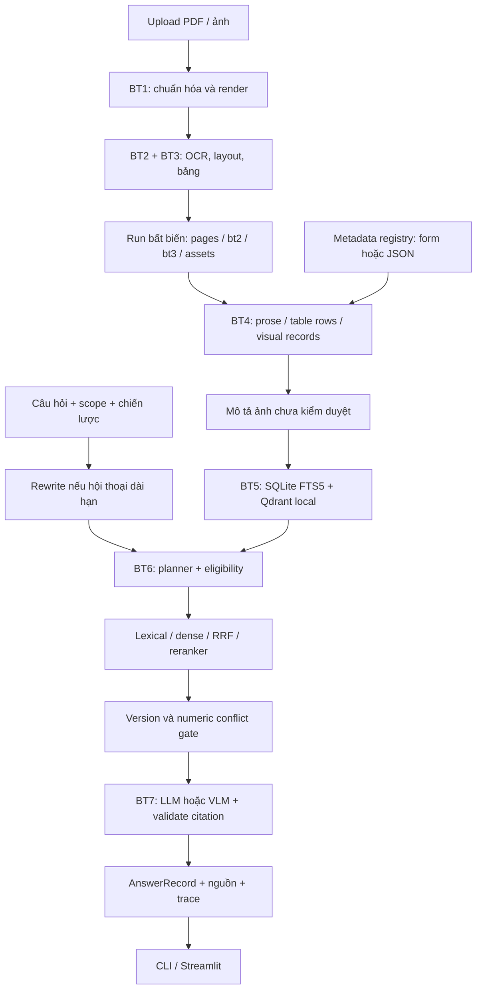

# Kiến trúc và luồng thực thi RAG

Ngày triển khai: 29/09/2026. Phạm vi: prototype một người trên Windows, RTX 4050 6 GB; tiếp nối BT1–BT3. Kế hoạch gốc: [RAG_PIPELINE_PLAN.md](RAG_PIPELINE_PLAN.md). Tài liệu này mô tả code thực tế, không coi toàn bộ giả thuyết trong kế hoạch là đã được chứng minh.

## 1. Những quyết định đã triển khai

- Một pipeline chung với bốn chiến lược truy xuất; người dùng chọn Auto hoặc ép chiến lược để so sánh.
- Local trước: BGE-M3, BGE reranker v2 M3, Qwen3-VL-2B GGUF Q4_K_M với projector Q8_0, llama.cpp b11235. Phiên bản model chính xác được lưu trong `.cache/rag/models.json` và manifest mỗi index.
- API là adapter giao thức `/chat/completions` có JSON/ảnh, chỉ bật bằng cấu hình tường minh. Chưa chọn nhà cung cấp, ngân sách; chưa gọi API trả phí.
- Metadata có provenance và trạng thái kiểm duyệt. Chỉ trường đã xác minh mới được dùng cho hard filter nghiệp vụ. Source/page là định danh của pipeline và được lọc trực tiếp.
- Hai phạm vi tìm kiếm: toàn kho hoặc danh sách tài liệu cụ thể. Hai chế độ hội thoại: tức thì độc lập và dài hạn lưu SQLite.
- Upload PDF/ảnh, OCR Anh/Việt, nhập/xuất metadata JSON và sửa bằng form. Không có xác thực nhiều người hoặc phân quyền ACL trong prototype này.

## 2. Sơ đồ hệ thống

## 3. Cấu trúc mã và trách nhiệm

| Vị trí | Trách nhiệm |
|---|---|
| `denso_a3/contracts.py` | `RagConfig`, `ChunkRecord`, `QueryPlan`, `RetrievedEvidence`, `AnswerRecord` |
| `bt4/chunking.py` | Chia prose, nhóm hàng bảng kèm header, fallback OCR span, visual record |
| `bt4/metadata.py` | Registry, provenance, xác minh hash/identity/dates |
| `bt5/store.py` | SQLite FTS5/BM25, Qdrant cosine, cùng predicate eligibility |
| `bt6/planner.py` | Nhận diện ngôn ngữ, intent, revision, soft preferences, làm rõ câu mơ hồ |
| `bt6/retrieval.py` | Lexical/dense, gộp alias, RRF, metadata boost, rerank |
| `bt6/conflicts.py` | So sánh fact số có nhãn và đơn vị, cùng họ tài liệu/thực thể |
| `bt7/answering.py` | Context, ảnh, prompt grounding, kiểm tra JSON và citation |
| `bt7/memory.py` | Lưu/mở từng cuộc trò chuyện, giới hạn context theo scope |
| `backends/artifacts.py` | Đọc run hoàn tất, xác minh ảnh theo hash |
| `backends/rag_models.py` | Embedding/reranker local; load/close theo giai đoạn |
| `backends/generation.py` | Quản lý llama-server do ứng dụng tạo; adapter API |
| `backends/bootstrap.py` | Tải model public và runtime từ repository chính thức |
| `pipeline/index_builder.py` | Hợp nhất run, build snapshot, cập nhật metadata |
| `pipeline/rag_runner.py` | Điều phối một request hỏi đáp |
| `pipeline/rag_cli.py`, `ui/app.py` | CLI và Streamlit dùng chung orchestration |
| `evaluation/rag_evaluator.py` | Nhãn nháp, scoped/global, EN/VI proxy, retrieval/end-to-end |

## 4. BT4–BT5: từ run đến index

`build_index(run_paths, output, config, registry_path)` thực hiện:

1. Đọc bảy artifact bắt buộc của run; kiểm tra schema, startup, số trang và tập page ID giữa BT2/BT3.
2. Hợp nhất nhiều run. Cùng ID nhưng khác hash nguồn là lỗi; tên revision/upload phải có định danh khác nhau.
3. Tạo metadata mặc định `null`, hoặc merge registry đã được kiểm tra source hash và đường dẫn tương đối.
4. Chia văn bản theo câu và ngân sách tokenizer. Mặc định 384 token, overlap 48. Bảng nhóm theo hàng, lặp header, giữ row/column/span và ô unknown. Table row quá dài giữ nguyên, embedding dùng cửa sổ thay vì bỏ phần đuôi.
5. Lưu `parent_id` để giữ liên kết với trang/bảng. Với bảng đủ ngắn, BT7 mở rộng context thành bảng hoàn chỉnh trên cùng trang.
6. Mỗi trang có visual record. Khi bật caption, VLM tạo mô tả để tìm kiếm; cache theo hash ảnh/model/prompt, đánh dấu chưa kiểm duyệt. Caption không phải bằng chứng độc lập.
7. Sao chép ảnh canonical theo SHA và file nguồn nếu hash khớp. Ảnh trong run được ưu tiên hơn đường dẫn cũ từ trước khi di chuyển project.
8. Embed một lần cho mỗi `content_key`; alias vẫn có chunk riêng theo nguồn để source filter đúng. BGE dùng CLS normalized; E5 tùy chọn dùng mean pooling và prefix query/passage.
9. Ghi SQLite, Qdrant và JSON vào thư mục `.building-*`; chỉ đổi tên thành snapshot đích sau khi hoàn tất. Thư mục lỗi có thể giữ để điều tra, không được mở như index `ready`.

Đầu ra gồm `manifest.json`, `registry.json`, `documents.json`, `pages.json`, `chunks.json`, `parents.json`, `records.sqlite`, `vectors/`, `assets/`, `sources/`. Output hiện hữu bị từ chối để tránh sửa index đang dùng. `rag-metadata` sao chép snapshot, sửa payload/registry và đổi fingerprint; không tính lại embedding.

## 5. Metadata-aware retrieval và nhiều kiến trúc

| Chế độ UI/CLI | Luồng | Điểm mạnh | Giới hạn |
|---|---|---|---|
| A `lexical` | FTS5/BM25 | Nhanh; mã và từ xuất hiện nguyên văn | Yếu với paraphrase/khác ngôn ngữ |
| B `dense` | BGE-M3 + cosine | Tìm nghĩa, đa ngôn ngữ | Tốn model load, có thể nhầm mã/số gần nhau |
| C `hybrid` | A+B rồi RRF | Cân bằng từ chính xác và ngữ nghĩa | Thêm cấu hình, chi phí truy xuất |
| D `visual` | Hybrid, visual candidate, VLM đọc tối đa hai ảnh | Đọc biểu đồ/chữ viết tay/ảnh | Latency và sai số thị giác; vẫn có thể abstain |
| `auto` | Hybrid; chuyển VLM theo intent hoặc visual evidence top hai | Người dùng không cần biết kiến trúc | Router heuristic cần đánh giá trên dữ liệu thật |

Rerank là công tắc độc lập với chiến lược. Muốn baseline A/B/C không rerank, dùng `configs/rag.baseline.json`. RRF cộng `1/(60+rank)` giữa nhánh; điểm này không phải xác suất đúng. Metadata suy đoán chỉ cộng điểm mềm; không loại tài liệu thiếu metadata.

Nếu số candidate không vượt số evidence được phép đưa vào context, code bỏ reranker vì toàn bộ candidate đều được giữ; lý do được ghi trong trace. Cấu hình demo dùng CUDA lần lượt cho embedding/reranker rồi mới VLM. Corpus mẫu khiến Auto chọn vision thường xuyên; đây chưa phải router tối ưu chi phí.

Hard filter được áp dụng **trước top-k** ở cả hai nhánh. SQLite dùng bảng ID tạm; Qdrant dùng `HasIdCondition` từ cùng tập eligible. Đây là cách đúng và dễ kiểm tra cho kho nhỏ. Nó quét metadata trong bộ nhớ và truyền danh sách ID, chưa tối ưu cho hàng triệu chunk; triển khai lớn nên chuyển Qdrant server và payload indexes.

Các field nghiệp vụ: `document_family_id`, `revision_id`, `effective_from`, `effective_to`, `document_type`, `issuing_authority`, `document_language`, `equipment_id`, `part_number`. Mỗi field gồm `value`, `origin`, `review_status`, `evidence`. `user_verified` và `source_verified` được tin cho filter; `unreviewed` không được dùng như thẩm quyền. Code kiểm tra nguồn và kiểu dữ liệu, không tự chứng minh việc người dùng đánh dấu verified là đúng.

## 6. Luồng một câu hỏi

`ask(index, question, config, strategy, filters, conversation_id, memory_path)`:

1. Kiểm tra index ready/schema và cấu hình.
2. Nếu dài hạn: đọc context cùng index/scope, dùng tối đa ba lượt gần nhất để viết lại câu độc lập. Câu trả lời trước chỉ giúp giải tham chiếu; bằng chứng factual phải truy xuất lại.
3. Planner giữ nguyên hard filter do người dùng chọn; revision không có metadata xác minh thì hỏi lại. Câu hỏi hiệu lực yêu cầu ngày đã xác minh; không lấy timestamp file làm version.
4. Chạy retrieval, loại alias theo content key, RRF, soft boost, reranker, lấy tối đa năm evidence mặc định.
5. Mở rộng pool đến các nguồn cùng family còn nằm trong scope để kiểm tra mâu thuẫn số. Không tự vượt source filter của người dùng.
6. Nếu có conflict: cảnh báo, dẫn các nguồn và không kết luận. Nếu không đủ evidence: abstain hoặc clarification.
7. Nếu cần: đọc ảnh canonical trực tiếp bằng VLM. Text và hình trong tài liệu luôn được đưa vào prompt như dữ liệu, không phải chỉ thị.
8. Local generation dùng schema ràng buộc status và enum evidence IDs, theo [ví dụ structured output chính thức của llama.cpp](https://github.com/ggml-org/llama.cpp/blob/master/examples/json_schema_pydantic_example.py). Sau sinh vẫn kiểm tra JSON, answer, evidence IDs và ảnh nguồn. Citation lạ bị từ chối; tối đa một lần yêu cầu sinh lại, không tự thay bằng nguồn khác. API adapter dùng JSON mode và hậu kiểm vì giao thức schema tùy nhà cung cấp.
9. Ghi timings/trace/usage vào `AnswerRecord`. Chỉ mode dài hạn ghi SQLite; mode tức thì không ghi query/history mặc định. CLI `--output` và evaluation ghi file khi được yêu cầu rõ ràng.

Citation gồm file tương đối, page vật lý bắt đầu từ 1 hoặc `null` với ảnh, page/chunk ID, image asset và bbox. Bbox dùng tọa độ normalized `[x0,y0,x1,y1]`, gốc trên trái. UI hiển thị ảnh trang và cho tải file nguồn; không tự coi citation tồn tại là claim đã đúng.

## 7. Conflict gate: phạm vi thực tế

Gate hiện nhận các dòng `thuộc tính: số đơn vị` hoặc `thuộc tính = số đơn vị`; yêu cầu family và equipment/part đã xác minh. Hỗ trợ chuẩn hóa Pa/kPa/MPa, mm/cm/m và một số đơn vị trực tiếp. Khác thuộc tính/thực thể không coi là conflict; 5 MPa và 5000 kPa là tương đương.

Đây là bộ phát hiện bảo thủ cho fixture số, chưa là bộ suy luận mọi quy trình mâu thuẫn. Prose, bảng nhiều cột phức tạp, OCR mất dấu thuộc tính, đổi đơn vị chưa hỗ trợ có thể bị bỏ sót. Trạng thái là `potential_conflict`; không khẳng định tài liệu thật sai. Prompt LLM cũng yêu cầu abstain khi thấy mâu thuẫn, nhưng không thay thế đánh giá conflict có nhãn thật.

Ngoài dòng văn bản, code nhận hàng bảng đơn giản gồm hai cột thuộc tính–giá trị/đơn vị hoặc ba cột thuộc tính–số–đơn vị. Hàng có ô gộp được bỏ qua để không tự suy quan hệ mơ hồ. Các cảnh báo lặp do một bảng xuất hiện trong nhiều chunk được gộp theo nguồn/thuộc tính/giá trị.

## 8. Tài nguyên, lỗi và giới hạn vận hành

Một request tại một thời điểm; index Qdrant local chỉ mở trong tiến trình đang truy xuất rồi đóng. Model embedding và reranker được giải phóng trước generator. Local server do code tạo chỉ bind `127.0.0.1`; port đã bị dùng thì báo lỗi, không chiếm server khác. CUDA được cấu hình tường minh, không fallback âm thầm.

Model reload theo request; số đo hiện bao gồm load model, chưa phải warm service giữ weights. Upload chạy OCR/build trong subprocess, tên file có batch ID chống đụng identity; file tối đa 50 MB theo UI. Upload/index nằm `.local/`, không chung lịch sử instant. Nội dung upload vẫn được lưu vì đó là kho tài liệu đã yêu cầu nhập.

Lỗi JSON/model/HTTP, thiếu model, hash ảnh sai, schema sai, scope rỗng đều báo rõ, không tạo đáp án giả. Prompt grounding và kiểm tra citation chỉ giảm sai sót; chưa có bộ kiểm chứng từng claim độc lập. OCR Việt đã hỗ trợ ở adapter nhưng chất lượng dấu cần cải thiện. Nhật chưa kiểm thử; API chưa kiểm thử với nhà cung cấp cụ thể; không có dữ liệu DENSO chính thức.

Kết quả kiểm thử và lệnh tái lập xem [hướng dẫn demo](RAG_DEMO_GUIDE.md). Giải thích lý do kỹ thuật xem [tài liệu technical dễ hiểu](RAG_TECHNICAL_EXPLAINED.md).
