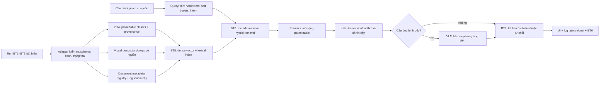

# Kế hoạch RAG cho DENSO A3 — tiếp nối BT1–BT3

**Ngày lập:** 28/09/2026  
**Cập nhật kiến trúc metadata-aware:** 29/09/2026  
**Hạn prototype:** 12/10/2026  
**Trạng thái:** phương án thiết kế để xem xét; chưa triển khai BT4–BT7 vào code.

## 1. Quyết định và phạm vi đã xác nhận

| Vấn đề | Quyết định cho prototype |
|---|---|
| Mục tiêu | Hoàn thiện BT4–BT7, có baseline và các cấu hình cải tiến để so sánh chất lượng, độ trễ và chi phí. |
| Dữ liệu | Dùng corpus hiện có trong `evaluation/data`; chưa có tài liệu DENSO hoặc QA chính thức. |
| Chế độ hỏi | Hỏi trong một tài liệu/ảnh được chọn **và** hỏi trên toàn bộ kho. |
| Ngôn ngữ | Câu hỏi và câu trả lời tiếng Anh/Việt ở prototype; thiết kế có thể chuyển sang corpus Nhật/Anh về sau. |
| Nội dung hình | Có nhánh riêng cho biểu đồ, ảnh, chữ viết tay; không xem OCR text là đủ cho các câu hỏi này. |
| Mâu thuẫn | Khi hai nguồn liên quan bất đồng mà chưa xác định hiệu lực, cảnh báo và **không kết luận** giá trị nào đúng. Dùng fixture synthetic có nhãn riêng để thử cơ chế. |
| Citation | Tên file + số trang PDF hoặc tên ảnh; số trang ảnh không được tự tạo. Giữ bbox/block/cell nội bộ để kiểm chứng và nâng cấp sau. |
| Máy chạy | Máy Windows hiện tại, RTX 4050 6 GB. So sánh phương án xử lý hoàn toàn local với API cloud; chưa có quyết định gửi tài liệu ra ngoài. |
| Đánh giá | Tạo nhãn bằng chứng nháp tự động cho 20–30 QA; **chưa có bước người soát nhãn**. Kết quả từ nhãn này chỉ là thăm dò. |
| Tiêu chí tối ưu | Cân bằng chất lượng, P95 latency và chi phí bằng thực nghiệm; chưa có ngưỡng bắt buộc. |
| Lượt công việc này | Hoàn thiện kế hoạch để người dùng xem và chọn kiến trúc; chưa viết mã RAG. |

Các tài liệu tham chiếu ngoài cây dự án hiện tại — bối cảnh A3 (`boi-canh-bai-toan-A3.md`), phân rã BT0–BT7 (`sub_problems.md`) và khung BT0 (`BT0_Evaluation_Framework.md`) — được dùng làm **nguồn mô tả bài toán và ý tưởng ban đầu**. Các gợi ý công nghệ, thứ tự phase và ví dụ metric trong đó không được xem là lệnh triển khai hoặc kết quả đã đo. Những lựa chọn ở bảng trên đến từ trao đổi trực tiếp với người dùng.

## 2. Điểm xuất phát thực tế

Package `denso_demo` trước khi chuyển lên gốc dự án đã có luồng CLI → BT1 ingest → GPU worker Docling → BT2 OCR → BT3 layout/table → artifacts → evaluation/review. [Runner](../denso_a3/pipeline/runner.py), [contract](../denso_a3/contracts.py), [normalizer](../denso_a3/backends/normalization.py), [README dự án](../README.md) và [báo cáo chạy thật](IMPLEMENTATION_REPORT.md) là căn cứ tích hợp. Chưa có package hoặc lệnh BT4–BT7.

- Run `results/full_200` có **67 trang logic**: 17 trang PDF và 50 ảnh; 47 ảnh canonical khác nhau, 20 alias. BT2 có 67 `ok`; BT3 có 60 `ok`, 7 `partial` ([performance](../results/full_200/performance.json)). `ok` là trạng thái thực thi, không phải xác nhận nội dung đúng.
- BT2 `text` là chuỗi OCR cells theo thứ tự thô. BT3 lưu `blocks[].reading_order`, liên kết span và bảng có row/column/rowspan/colspan. Các vị trí `unknown_grid_positions` là **chưa biết**, không được biến thành ô trống. Markdown bảng có thể mất ngữ nghĩa merged cell; nguồn chuẩn là JSON grid và ảnh gốc.
- Trang ảnh có `page_number=null`; PDF đánh số trang vật lý từ 1. `page_id`/`document_id` gắn với đường dẫn nguồn, vì vậy thay nội dung cùng đường dẫn phải được nhận bằng source/image SHA, không chỉ bằng ID. Alias chia sẻ ảnh nhưng phải giữ danh tính nguồn khi dẫn chứng.
- Chạy hiện tại cấu hình OCR tiếng Anh (`language=en`). PDF `.ocr` chưa được soát; CER chuẩn hóa whitespace khoảng 10,79% trên 17 trang là mức **agreement** với reference đó, không phải độ chính xác được chứng nhận. Bảng pilot có lỗi topology/ô trống ([metrics](../results/full_200/metrics.json)).
- `dataset_test.json` có 50 QA tiếng Anh gắn với 50 tên ảnh nhưng chỉ 30 ảnh canonical. Có nhãn table/list, form, image/photo, figure/diagram và handwritten. QA hiện không có evidence được kiểm duyệt; nhiều câu chỉ rõ nghĩa khi biết ảnh nguồn. Nó chưa kiểm chứng truy xuất Việt→Nhật hoặc tài liệu có nhiều phiên bản ([dataset](../evaluation/data/dataset_test.json)).

**Hệ quả:** BT4 phải đọc artifact của một run hoàn tất và giữ provenance/quality. BT0 cho RAG phải được xây song song. Không đưa câu hỏi, đáp án hoặc nhãn đánh giá vào index hay prompt truy vấn.

## 3. Các kiến trúc có thể dùng

Các phương án dùng cùng contract đầu vào BT1–BT3 và cùng bộ QA để so sánh công bằng. “Nhanh/chậm” dưới đây là kỳ vọng thiết kế, **chưa phải benchmark trên máy hiện tại**.

| Phương án | Luồng | Điểm mạnh | Điểm yếu / khi không phù hợp |
|---|---|---|---|
| **A. Lexical RAG** | BT3 → chunk text/bảng → BM25/FTS → LLM | Ít model, dễ debug; tốt cho mã thiết bị, tên riêng và số chính xác; baseline rẻ. | Hỏi tiếng Việt trên tài liệu tiếng Anh/Nhật yếu; OCR sai từ khóa làm mất recall; không giải quyết hình. |
| **B. Dense multilingual RAG** | BT3 → chunk → embedding đa ngữ → vector store → LLM | Có khả năng tìm khác ngôn ngữ và diễn đạt khác từ; đơn giản hơn hybrid. | Dễ bỏ sót mã/số/đơn vị; bảng dài dễ bị cắt; chất lượng Việt→Anh/Nhật chưa đo; vẫn phụ thuộc OCR. |
| **C. Hybrid, table-aware, rerank** | Chunk giữ bảng → lexical + dense → fusion → reranker → LLM | Kết hợp exact match và semantic match; có thể đo riêng từng nhánh; phù hợp câu hỏi số/bảng và Việt→Anh. | Hai index và thêm reranker gây phức tạp, RAM/VRAM và P95 tăng; cần kiểm soát đồng bộ index. |
| **D. Hybrid + nhánh thị giác chọn lọc** | C + caption/visual candidate index → VLM xem crop/trang gốc khi cần → LLM | Bao phủ biểu đồ, ảnh, chữ viết tay mà text extraction bỏ lỡ; chỉ trả giá VLM cho truy vấn cần ảnh. | Caption có thể thiếu hoặc bịa số; visual retrieval toàn kho khó; chi phí/latency lớn nhất; 6 GB VRAM buộc đo và điều phối model. |

**Đề xuất:** lấy **C** làm kiến trúc đích cho truy vấn văn bản/bảng; triển khai **A và B như ablation** từ cùng chunk/index pipeline. Bổ sung **nhánh D chọn lọc** cho câu hỏi ảnh. Không dùng D cho mọi truy vấn. Version conflict là một cổng kiểm tra bằng chứng trước khi sinh đáp án, tách khỏi phương án retriever để có thể bật/tắt và đo riêng. Quyết định giữ C hay hạ về A/B phụ thuộc kết quả trên QA hiện có và P95 trên máy thực.

### 3.1. Metadata-aware retrieval phù hợp với kiến trúc nào?

**Phương án C là lõi phù hợp nhất**, mở rộng bằng nhánh D khi câu hỏi cần nhìn ảnh. Metadata-aware là lớp **xác định phạm vi và điều chỉnh thứ hạng** dùng chung cho A/B/C/D, không cần xây một pipeline RAG thứ năm. Bộ lọc nguồn/loại tài liệu/phiên bản đã xác minh làm giảm nhiễu cho cả lexical lẫn dense; fusion vẫn giữ lợi thế tìm mã/số chính xác và câu hỏi diễn đạt khác từ. Với Qdrant, payload filter có thể áp dụng ngay trong truy vấn dense/sparse/hybrid, và các trường thường lọc có thể được đánh index ([filtering](https://qdrant.tech/documentation/search/filtering/), [payload indexing](https://qdrant.tech/documentation/manage-data/indexing/)). Đây là khả năng của công cụ, chưa phải kết quả đo trên DENSO.

Metadata hiện có trong `pages.json`/`documents.json` gồm source, hash, loại file/trang, số trang PDF, geometry, trạng thái extraction và alias. Chúng đủ cho **lọc theo file/trang người dùng chọn** và truy vết citation. Chúng **chưa đủ** cho lọc tài liệu “đang hiệu lực”: chưa có `document_family_id`, revision, ngày hiệu lực, đơn vị ban hành, loại tài liệu nghiệp vụ hoặc ngôn ngữ tài liệu đã xác minh. `language=en` chỉ là cấu hình OCR; `page_type` là loại media; mtime, PDF creation/modification date và thời điểm chạy không phải revision/effective date. ID từ QA mẫu không phải khóa tài liệu DENSO đáng tin.

Tạo **document metadata registry** riêng, liên kết bằng source SHA + document/page IDs, rồi sao chép các trường cần tìm vào payload của từng chunk/visual record. Trường dự kiến: `document_family_id`, `revision_id`, `effective_from/to`, `document_type`, `issuing_authority`, `document_language`, `equipment_id`/`part_number`, `access_scope`. Mỗi giá trị nghiệp vụ có `origin` (người nhập/nguồn văn bản/OCR/tên file/PDF metadata), evidence page/region, `review_status` và mức tin cậy; chưa biết để `null`, không đoán từ tên file. `access_scope` nếu có phải đến từ nguồn quyền truy cập được kiểm soát, không từ OCR.

| Mức dùng metadata | Ví dụ | Quy tắc |
|---|---|---|
| **Bộ lọc cứng** | Quyền truy cập; file/trang người dùng đã chọn; revision được yêu cầu rõ và đã xác minh | Áp dụng **trước retrieval ở mọi nhánh**. Không tự mở rộng nếu không có kết quả; báo thiếu nguồn hoặc hỏi lại. |
| **Ưu tiên mềm** | Loại tài liệu, mã thiết bị, heading, ngôn ngữ/phiên bản suy ra từ OCR hoặc câu hỏi | Tăng điểm hoặc ưu tiên candidate, giữ cả metadata `null` trong tập tìm kiếm. Không loại evidence chỉ vì một field thiếu/chưa soát. |
| **Kiểm tra sau truy xuất** | Đơn vị đo, hiệu lực, nguồn ban hành, version conflict, sự khớp của citation | Kiểm chứng trên evidence gốc; nếu chưa rõ hiệu lực hoặc OCR `partial`, trả trạng thái bất định/abstain. |

Khi hai nhánh chạy qua Qdrant + SQLite FTS5, **cùng một `QueryPlan` filter** phải được biên dịch sang cả hai backend trước khi lấy top-k. Chỉ lọc top-k sau retrieval có thể bỏ lỡ đúng evidence ở ngoài top-k ban đầu. Với Qdrant hybrid nhiều prefetch, đặt filter trên từng nhánh prefetch ([hướng dẫn filtered hybrid](https://qdrant.tech/course/beginners/module-3/filtering/)). Không mặc định `active=true` cho mọi câu hỏi: điều đó che mất bản cũ cần so sánh khi phát hiện mâu thuẫn. Nếu người dùng hỏi một revision cụ thể, chỉ trả lời theo revision đó và nêu rõ phạm vi.

### 3.2. Có thể chạy đồng thời nhiều kiến trúc không?

**Có, ở hai cấp độ khác nhau:**

1. **Trong một truy vấn:** C chạy lexical và dense cùng lúc, hợp nhất bằng RRF, rồi rerank; nhánh table/visual và kiểm tra conflict được bật theo nhu cầu. [Qdrant hybrid Query API](https://qdrant.tech/documentation/search/hybrid-queries/) hỗ trợ prefetch nhiều biểu diễn và fusion. Nếu vẫn dùng SQLite FTS5 riêng như kế hoạch hiện tại, fusion diễn ra trong orchestration; không giả định Qdrant tự chạy BM25 của SQLite.
2. **Để thử nghiệm:** A, B, C và C+D là các cấu hình trên **cùng artifact BT1–BT4, cùng registry và cùng QA**. Có thể chạy tuần tự hoặc shadow mode để so sánh, không cần OCR/chunk lại mỗi lần. Chỉ index vector riêng khi đổi embedding model; một truy vấn production không cần gọi nhiều LLM chỉ để so kiến trúc.

Với 50 QA mẫu và nhãn evidence chưa kiểm duyệt, **không nên huấn luyện router phức tạp** hay chỉ chọn duy nhất A *hoặc* B theo một classifier. Mặc định online là C metadata-aware; router ban đầu dựa trên quy tắc minh bạch để bật tác vụ nặng, và nếu không chắc thì giữ hybrid. Cách này tránh mất evidence vì chọn nhầm một retriever, đồng thời không gọi VLM cho mọi câu. Có thể đo một router “tiết kiệm” chọn A/B ở giai đoạn sau bằng tỷ lệ sai route, Hit@5 và P95 so với C mặc định.

| Cách chọn đường xử lý | Phù hợp khi | Đánh đổi | Quyết định cho prototype |
|---|---|---|---|
| **C luôn chạy lexical + dense** | Muốn baseline online ổn định, chưa đủ nhãn để tin router | Hai nhánh retrieval tốn thêm tài nguyên nhưng dễ đo và ít nguy cơ chọn sai nhánh | **Mặc định**; metadata filter áp dụng cho cả hai. |
| **Auto router** | Cần bật table expansion, VLM hoặc conflict check theo nội dung câu hỏi | Route sai có thể tăng chi phí hoặc mất evidence; cần log và so với C mặc định | Dùng quy tắc rõ ràng cho nhánh nặng, fallback về C khi không chắc. |
| **Người dùng chọn A/B/C/D** | Thử nghiệm, demo kỹ thuật, debug lỗi cụ thể | Người dùng nghiệp vụ phải hiểu các thuật ngữ retriever; kết quả các mode có thể khác nhau | Chỉ hiển thị trong Advanced/Benchmark, không là bước bắt buộc. |

| Dấu hiệu câu hỏi | Route mặc định | Metadata và kiểm tra thêm |
|---|---|---|
| Người dùng chọn tài liệu/ảnh hoặc revision rõ | C trong phạm vi đã chọn | Hard filter theo source/revision đã xác minh; không suy revision từ mtime. |
| Mã linh kiện, số hiệu, đơn vị hoặc tên chính xác | C, ưu tiên lexical nhưng vẫn giữ dense | Match mã đã chuẩn hóa; đối chiếu ký tự OCR và đơn vị trước trả lời. |
| Câu hỏi khái niệm hoặc hỏi tiếng Việt trên nguồn Anh | C, dense + lexical | Metadata suy đoán chỉ là soft boost; câu trả lời theo ngôn ngữ hỏi. |
| Số liệu trong bảng | C + table chunks/parent expansion | Kiểm tra hàng/cột/merged cell và cờ `unknown_grid_positions`. |
| Biểu đồ, ảnh hoặc chữ viết tay | C trên text/caption để tìm candidate, rồi D | VLM chỉ xem crop/trang ứng viên; không lấy caption làm ground truth. |
| So sánh phiên bản hoặc hỏi tài liệu “hiện hành” | C trên các version liên quan + conflict gate | Chỉ lọc “hiện hành” khi hiệu lực được xác minh; nếu không, cảnh báo và không kết luận. |
| Câu hỏi toàn kho thiếu đối tượng | Yêu cầu làm rõ hoặc liệt kê nguồn | Không tự chọn một file hay một “kiến trúc” để đoán đáp án. |

**UI:** người dùng thông thường chọn **phạm vi tài liệu**; chế độ `Auto` là mặc định. Một mục **Advanced/Benchmark** có thể cho nhóm phát triển chọn `A lexical`, `B dense`, `C hybrid`, `C + visual` hoặc ép visual route để debug và so sánh. Dropdown kiến trúc không phải bước bắt buộc trước mỗi câu hỏi. Cần hiển thị route đã dùng và lý do trong log/benchmark, không đưa thuật ngữ backend vào câu trả lời thông thường.

### Local so với cloud

| Cách chạy | Ưu điểm | Chi phí/rủi ro và điều kiện |
|---|---|---|
| **Local mặc định để thử** | Dữ liệu ở máy; chi phí API bằng 0; tái lập phiên bản model. | GPU 6 GB không thể mặc định chứa đồng thời Docling, embedder, reranker và VLM/LLM. Tách bước offline/online, giới hạn context và concurrency, đo VRAM thực. LLM/VLM nhỏ có thể sai số kỹ thuật. |
| **Cloud có cấu hình riêng** | Giảm áp lực VRAM, có thể thử model mạnh và so chất lượng. | Gửi nội dung trang/chunk ra ngoài, chi phí theo truy vấn, phụ thuộc mạng và chính sách dữ liệu. Chỉ dùng với tài liệu DENSO thật sau khi có quyết định rõ về quyền gửi dữ liệu. Không tự chuyển local sang cloud khi lỗi. |

Ứng viên để benchmark, không mặc định là “tốt nhất”: [BGE-M3](https://github.com/FlagOpen/FlagEmbedding/blob/master/docs/source/bge/bge_m3.rst) (dense/sparse, 1024 chiều, context dài) và [multilingual-e5-large](https://huggingface.co/intfloat/multilingual-e5-large) (1024 chiều, giới hạn 512 token, cần `query:`/`passage:`) cho embedding; [bge-reranker-v2-m3](https://huggingface.co/BAAI/bge-reranker-v2-m3) cho rerank; [Qwen3-4B](https://huggingface.co/Qwen/Qwen3-4B) cho sinh câu trả lời local. Model card không chứng minh chất lượng trên corpus này. Với cloud có thể đo một cặp embedding/reranker đa ngữ như [Cohere](https://docs.cohere.com/docs/cohere-embed), cộng một LLM/VLM theo chính sách dữ liệu và ngân sách khi được chốt.

## 4. Kiến trúc đích và luồng dữ liệu

### 4.1. Ranh giới tích hợp

BT4 nhận `--run <results/run>` và đọc `pages.json`, `bt2.json`, `bt3.json`, `run_config.json`, `runtime.json` của **cùng một run hoàn tất**; ghép bằng `page_id`, kiểm tra số record, schema và fingerprint. Không gọi lại OCR khi thử chunk/embedding. `results/full_200` là run đầu để phát triển, không hard-code vào API. BT4–BT7 ghi artifact vào thư mục RAG mới có manifest; không sửa kết quả BT1–BT3. Run dở dang hoặc thiếu aggregate bị từ chối rõ ràng.

### 4.2. BT4 — chunking giữ ngữ cảnh và bảng

1. Duyệt BT3 blocks theo `reading_order`, dựng heading path khi có section header. Gộp paragraph/list theo section và câu. Bắt đầu benchmark ở khoảng **300–400 token/chunk, overlap 40–60 token**, sau đó tune trên evidence Recall@5; đây là tham số thử nghiệm, không phải ngưỡng đã tối ưu.
2. Bảng là đơn vị nội dung riêng, kèm heading/caption, header hàng/cột, đơn vị và các ô có vị trí. Giữ `rowspan`/`colspan`, `unknown_grid_positions`, `status` và parent table ID. Bảng vừa giới hạn token đi thành một chunk; bảng lớn chia theo nhóm hàng, lặp header và giữ link đến toàn bảng. Không cắt ngang một hàng; không biến ô chưa biết thành dữ kiện.
3. Text OCR BT2 chỉ là nhánh recall phụ khi BT3 bỏ sót vùng, gắn cờ `raw_ocr_fallback`; không trộn nó vào prose như thể đã có reading order. Hạn chế lặp bảng và OCR text tương ứng.
4. Với figure/chart/form/handwriting, tạo visual record và crop/trang gốc. VLM local thử [Qwen3-VL-2B GGUF](https://huggingface.co/Qwen/Qwen3-VL-2B-Instruct-GGUF/tree/main) trước, so với [4B](https://huggingface.co/Qwen/Qwen3-VL-4B-Instruct-GGUF/tree/main) nếu VRAM cho phép. Caption/facts do VLM tạo mang cờ `unverified_visual_description`; câu trả lời có số phải kiểm tra lại trên ảnh gốc. Để tìm hình trên toàn kho, index caption cùng provenance; nếu Recall thấp, thử embedding ảnh-văn bản như [Qwen3-VL-Embedding-2B](https://huggingface.co/Qwen/Qwen3-VL-Embedding-2B) ở nhánh nghiên cứu riêng. Chưa giả định model này chạy ổn trên Windows/6 GB.

`ChunkRecord` dự kiến gồm `chunk_id`, `parent_id`, `kind`, `text_for_embedding`, `text_for_answer`, heading/caption, `page_id`, `document_id`, `source_relative`, `source_sha256`, `image_sha256`, `page_number|null`, block/span/table/cell IDs, bbox normalized, extraction status/quality, alias occurrences, **metadata registry ID + các field cần lọc kèm trạng thái kiểm duyệt**, chunk-policy version. Hash chunk phải bao gồm **nội dung nguồn và chính sách chunk**, vì ID theo đường dẫn không đổi khi file bị thay. Ảnh alias chỉ cần tính embedding nội dung một lần nhưng vẫn giữ mọi nguồn dẫn hợp lệ. Khi business metadata được sửa mà text không đổi, refresh payload/index metadata và manifest mà không giả định phải OCR lại.

### 4.3. BT5 — embedding và index

- Xây hai nhánh đo độc lập trên cùng chunk: BGE-M3 và multilingual-e5-large. Với E5 thêm đúng tiền tố query/passage và không để bảng vượt giới hạn token; giữ model revision, dimension, tokenizer và normalization trong index manifest. Không so điểm cosine của hai model như cùng thang đo.
- Đề xuất **Qdrant local path** cho vector/payload và **SQLite FTS5** cho lexical/BM25 trên corpus nhỏ. Qdrant local persist không cần server, nhưng chỉ cho một process sở hữu cùng path và có ngưỡng thực dụng cho dataset nhỏ ([Qdrant client](https://github.com/qdrant/qdrant-client/blob/master/README.md), [local implementation](https://github.com/qdrant/qdrant-client/blob/master/qdrant_client/local/qdrant_local.py)). Với benchmark tối giản có thể thay vector store bằng [FAISS CPU IndexFlat](https://github.com/facebookresearch/faiss/wiki/Guidelines-to-choose-an-index); khi cần nhiều user/cập nhật đồng thời, chuyển Qdrant server. FTS5 cần tokenizer/kiểm thử riêng khi corpus chuyển sang tiếng Nhật; [trigram](https://www.sqlite.org/fts5.html) có hạn chế với chuỗi dưới ba ký tự.
- Lập payload index cho các metadata thật sự lọc thường xuyên (ví dụ source/document family/revision đã xác minh, loại block, access scope), nhưng chỉ sau khi đo nhu cầu; không index mọi trường suy đoán. Đồng bộ khóa chunk và filter semantics giữa Qdrant và FTS5 để lexical/dense không tìm trên hai tập tài liệu khác nhau. [Qdrant indexing](https://qdrant.tech/documentation/manage-data/indexing/) hỗ trợ tối ưu truy vấn có filter.
- Index build vào vị trí mới rồi atomic switch theo manifest; không ghi đè index cũ đang phục vụ. Manifest lưu run/code/schema hash, model/chunk config, count, thời gian build và QA leakage check. Khi source hash, extraction run hoặc model đổi, chỉ mục liên quan phải invalidated/rebuild. Không trộn vector từ hai model vào một collection.
- Chạy embedding/index offline sau BT1–BT3. Lúc phục vụ truy vấn, load reranker/LLM/VLM theo cấu hình và đo VRAM; không giữ Docling GPU worker đang chạy. Kích thước file model không phải VRAM thực.

### 4.4. BT6 — retrieval, reranking và mâu thuẫn

1. **QueryPlan và scope:** tách tín hiệu người dùng nói rõ (file, revision, phạm vi) khỏi metadata suy luận từ câu hỏi. Hard filter cho nguồn/quyền/revision đáng tin; soft boost cho nhãn suy đoán. Nếu chọn nguồn, lọc theo source identity/alias **trước truy xuất ở cả hai index**; nếu hỏi toàn kho, tìm mọi nguồn và khử trùng nội dung, vẫn giữ citation tới đúng file. Câu hỏi toàn kho không đủ định danh (“tên công ty là gì?”) phải hỏi làm rõ hoặc nêu các nguồn khả dĩ, không ép một đáp án.
2. Chạy lexical và dense top-k riêng trên **cùng tập hợp lệ** (điểm bắt đầu 20 mỗi nhánh), fusion bằng RRF, sau đó rerank khoảng 20–30 candidate và chọn 4–6 evidence cho LLM; tune `k` bằng Recall@K và P95. Giữ filter, score từng nhánh, rank, route và reason trong trace. Thêm parent/table context chỉ sau khi chọn candidate để không lấp context bằng toàn bảng dài. Nếu không có hit từ metadata mềm, mở rộng lại một lần và ghi trace; không tự bỏ hard filter.
3. **Version registry** là metadata tách biệt: document family/part number, revision, issue/effective date, trạng thái hiệu lực và nguồn xác minh. Corpus hiện chưa có trường version đáng tin. Không suy ra “mới nhất” từ `mtime` hay tên file. Candidate conflict phải cùng thực thể + thuộc tính, có giá trị/đơn vị/procedure khác nhau và provenance độc lập. Bước so sánh dùng normalization/heuristic trước, LLM chỉ hỗ trợ phân loại các trường hợp khó; lỗi OCR/bảng `partial` tạo trạng thái `uncertain`, không khẳng định conflict thật.
4. Nếu conflict có cơ sở và chưa rõ hiệu lực: trả cả nguồn liên quan, cảnh báo, **không kết luận**. Nếu không đủ evidence: abstain. Fixture synthetic gồm cặp revision và các case không mâu thuẫn/khác đơn vị/nguồn OCR sai, được index trong bộ thử riêng, không pha vào QA thật. Báo precision, recall, false-warning rate trên fixture như kiểm tra cơ chế, không coi là hiệu năng trên tài liệu DENSO.

### 4.5. BT7 — câu trả lời, citation và giao diện

- Đầu vào LLM là câu hỏi, evidence IDs, nội dung đã chọn, quality/version flags. Prompt yêu cầu chỉ trả lời từ evidence, giữ nguyên số/đơn vị, dẫn `source_relative` + trang PDF hoặc ảnh, và nói “không đủ bằng chứng” khi cần. Câu trả lời theo ngôn ngữ câu hỏi (Anh/Việt); tên kỹ thuật/đơn vị nguồn giữ nguyên. Nội dung tài liệu được coi là **dữ liệu**, không phải chỉ thị cho agent/chatbot.
- Citation được validate sau sinh: ID phải nằm trong evidence thực, file tồn tại, số trang là trang vật lý PDF; với ảnh hiển thị tên ảnh thay vì gán trang 1. Bbox nội bộ cho phép mở đúng crop sau này nhưng yêu cầu UI hiện tại chỉ file+trang/ảnh.
- UI prototype nhẹ (ví dụ Streamlit) có ô chọn “toàn kho / tài liệu”, câu hỏi, đáp án, citation mở được, cảnh báo mâu thuẫn, lý do từ chối và latency. `Auto` là route mặc định; menu Advanced/Benchmark tùy chọn cho phép ép A/B/C/D để đo hoặc debug, không bắt người dùng phổ thông chọn kiến trúc. Cùng API dùng được từ CLI để benchmark không phụ thuộc UI. Không hiển thị `status=ok` như độ tin cậy đã kiểm định.
- `AnswerRecord` gồm answer, language, cited evidence IDs, conflict/abstain status, retrieval trace, visual route, model/config, latency theo bước và API cost nếu có. Không lưu bí mật hoặc toàn bộ prompt tài liệu vào log mặc định.

### 4.6. Contract và lệnh dự kiến

| Interface | Input → output | Lỗi/side effect cần quy định |
|---|---|---|
| `build_chunks(run, policy)` | Một run BT1–BT3 hoàn tất → `ChunkRecord[]`, visual records và manifest | Từ chối schema/run thiếu; chỉ ghi thư mục artifact mới. |
| `build_index(chunks, model_config)` | Chunk/visual descriptors → vector index, lexical index, `IndexManifest` | Model/dimension/hash phải khớp; build atomically, không trộn phiên bản. |
| `plan_query(question, scope, metadata_registry)` | Câu hỏi + lựa chọn nguồn → `QueryPlan` gồm hard filters, soft preferences, intent, route và mức tin cậy | Không biến metadata suy đoán thành filter cứng; câu hỏi mơ hồ có thể yêu cầu làm rõ. |
| `retrieve(question, query_plan, config)` | Câu hỏi + `QueryPlan` → `RetrievedEvidence[]` có score từng nhánh, metadata provenance và citation pointer | Phân biệt no-hit, source không tồn tại, index lỗi; áp dụng cùng hard filters cho mọi backend và không trả nguồn ngoài scope. |
| `answer(question, evidence, policy)` | Evidence đã xếp hạng → `AnswerRecord` hoặc abstain/conflict | Chỉ citation từ evidence, ghi latency/cost theo bước; VLM route có provenance ảnh. |

CLI dự kiến `rag-build --run ... --output ...`, `rag-ask --index ... [--source ...] [--strategy auto|lexical|dense|hybrid|visual]`, `rag-evaluate --index ... --qa ...`; UI gọi cùng lớp orchestration, không giữ logic truy xuất riêng. Cấu hình baseline/ablation, metadata registry và chính sách route lưu thành file có version để tái lập. Đây là contract thiết kế; tên lệnh có thể được điều chỉnh khi bắt đầu code.

## 5. BT0 cho RAG: đánh giá và thí nghiệm

### Dữ liệu kiểm tra

1. Dùng cả 50 QA hiện có làm **development set** cho chế độ chọn ảnh. Tạo evidence draft cho ít nhất 20–30 câu bằng answer matching + BT3 span/table/visual localization; mỗi nhãn có `source`, `bbox/block/cell`, `method`, `review_status=unreviewed`. Nếu answer không nằm trong OCR, ghi `not_located`, không tự tạo evidence.
2. Với chế độ toàn kho, tạo tập riêng gồm câu hỏi đã làm rõ đối tượng/tài liệu từ các QA có evidence, để không chấm sai vì câu hỏi gốc thiếu ngữ cảnh. Giữ câu gốc mơ hồ làm tập kiểm tra hành vi yêu cầu làm rõ. Không dùng nhãn/đáp án này trong BT4–BT7 runtime.
3. Tạo 20–30 câu hỏi Việt dịch từ tập tiếng Anh với provenance và trạng thái `auto_translated_unreviewed`; chỉ dùng làm proxy Việt→Anh. **Không có** corpus tiếng Nhật, nên chưa thể báo kết quả Việt→Nhật hoặc Nhật→Anh. Khi nhận tài liệu thật, phải chạy lại OCR, annotation và benchmark theo ngôn ngữ đó.
4. Split/đánh giá theo canonical image SHA và lineage tài liệu khi có, không theo QA ID hoặc tên alias. Báo riêng table, prose, form, photo, chart, handwriting; nhóm rất nhỏ chỉ mô tả từng case, không suy rộng phần trăm.

### Metrics và ablation

| Lớp | Metric / cách đọc |
|---|---|
| BT4–BT6 | Evidence Hit@1/5 và Recall@5, MRR; tách scoped/global, English/Vietnamese proxy, prose/table/visual. Nhãn chưa soát → số đo thăm dò. |
| Metadata/router | Filter correctness (nguồn hợp lệ/nguồn bị loại), tỷ lệ hard-filter làm mất evidence, tỷ lệ route sai, Hit@5 theo route và tỷ lệ phải mở rộng tìm kiếm. So `Auto` với C luôn chạy trên cùng câu hỏi. |
| BT7 | Exact/numeric+unit correctness khi phù hợp, semantic correctness có kiểm tra, groundedness, citation validity và citation correctness, abstention đúng; answer string có sẵn không thay thế evidence. |
| Conflict | Precision/recall/false warning trên fixture synthetic, ghi rõ sample size và không ngoại suy sang DENSO. |
| Hiệu năng | P50/P95 end-to-end và từng bước: retrieval, rerank, VLM, generation; đo warm và cold riêng, GPU memory, index time/storage, chi phí API/câu nếu bật. |

Chạy trên cùng corpus, QA và settings generation: **A lexical**, **B dense**, **C hybrid**, **C + metadata filters/boosts**, **C + rerank**, **C + table-aware so với flat chunks**, **C + vision route**, **C + conflict gate**, và **Auto router so với C luôn chạy**. Giữ source filter bắt buộc như nhau ở mọi cấu hình; chỉ tắt metadata *soft boost* khi làm ablation để không phá quyền truy cập/phạm vi người dùng chọn. Với mỗi cải tiến báo chênh lệch chất lượng và P95/cost so baseline, không chỉ báo một con số tổng. Kiểm tra thủ công các câu sai quan trọng trước khi kết luận nguyên nhân vì nhãn evidence chưa soát.

### Ngưỡng đề xuất để ra quyết định (chưa phải cam kết)

- **Tính toàn vẹn:** 100% citation trỏ tới nguồn/trang/ảnh có trong run; zero citation bịa; mọi BT3 `partial` và visual caption chưa kiểm chứng được gắn cờ. Đọc được cả hai chế độ hỏi và chạy đủ 50 QA hiện có, ghi lỗi thay vì bỏ qua.
- **Retrieval:** mục tiêu khám phá Hit@5 ≥80% trên evidence draft của scoped set và ≥70% trên global set đã làm rõ. Vì nhãn tự động chưa soát, chỉ dùng làm ngưỡng điều tra; không tuyên bố đạt accuracy chính thức.
- **Latency trên máy hiện tại, một request:** mục tiêu thử nghiệm P95 warm ≤20 giây cho câu text và ≤45 giây cho câu cần VLM; ghi cold start riêng. Nếu không đạt, giảm `k`, context, model/visual route hoặc chuyển cloud sau khi có chính sách dữ liệu, rồi đo lại. Không dùng cache OCR/index build để làm đẹp query latency.
- **Cải tiến:** giữ table-aware/rerank/vision nếu cải thiện case mục tiêu mà P95/cost tăng chấp nhận được; với nhóm visual quá ít, xem từng câu thay vì yêu cầu một tỷ lệ phần trăm. Chi phí API chưa có ngân sách: báo thực tế theo 100 câu và không tự bật cloud.

### Kiểm chứng kỹ thuật khi triển khai

- Test contract với run thiếu/khác schema, `page_number=null`, source đổi nội dung cùng đường dẫn, alias cùng ảnh khác nguồn và index invalidation. Test chunk bảng có merged cell/unknown grid, text BT3 thiếu và OCR fallback mà không nhân đôi evidence.
- Test retrieval scope (một nguồn/toàn kho), query mơ hồ, duplicate source, fusion/rerank deterministic, citation chỉ trỏ evidence hợp lệ, conflict/abstain trên positive và negative fixtures. Test cùng hard filter ở lexical/dense, metadata `null` không bị loại bởi soft preference, không tự bỏ access/source filter khi zero-hit, revision không suy ra từ file timestamp, và route image/table chỉ bật khi cần.
- Tách unit/integration test không tải model khỏi **real benchmark** trên `full_200` và QA. Báo rõ số đo nào từ fixture/mock, số đo nào từ model và GPU thật; ghi model revision, config, index manifest và cold/warm state.

## 6. Thứ tự triển khai đề xuất đến 12/10

| Thời gian | Công việc và đầu ra kiểm tra được |
|---|---|
| **29/09** | Chốt contract/manifest, document metadata registry tối thiểu, `QueryPlan`, QA evidence draft và global-question variants; khóa run BT1–BT3 đầu vào. |
| **30/09–02/10** | BT4 table-aware + flat baseline; BT5 index lexical/dense; kiểm tra hash, alias, `partial`, bbox và rebuild. |
| **03/10–05/10** | BT6 scoped/global retrieval, metadata filters/boosts, rule-based route, fusion, rerank, trace; chạy Recall/Hit và latency trước LLM. |
| **06/10–07/10** | BT7 answer/citation/abstention, CLI + UI tối thiểu; benchmark end-to-end Anh/Việt. |
| **08/10–09/10** | Visual caption + on-demand VLM pilot; conflict gate và fixture synthetic; kiểm tra VRAM/P95. |
| **10/10** | Ablation A/B/C/D và Auto, phân tích lỗi filter/route, chất lượng và cost/latency theo loại câu hỏi. |
| **11/10** | Đóng băng demo, chọn cấu hình theo số liệu, cập nhật README và báo cáo giới hạn. |
| **12/10** | Nộp prototype/ý tưởng với số đo và ví dụ traceable; không trình bày nhãn nháp như ground truth đã kiểm duyệt. |

Các mốc là kế hoạch cho **một máy 6 GB**. Nếu nhánh ảnh hoặc LLM local vượt VRAM/thời gian, vẫn giữ baseline text/table chạy được và báo nhánh đó là kết quả thử nghiệm có giới hạn; không đổi backend âm thầm. Cấu trúc code khi triển khai theo quy tắc dự án: shared contracts trong `denso_a3/contracts.py`; `bt4/`, `bt5/`, `bt6/`, `bt7/` mỗi package riêng; adapters/index readers, orchestration, CLI và evaluation tách trách nhiệm. Khi code làm đổi luồng, API, setup hoặc usage, cập nhật [README dự án](../README.md) với entry point, thứ tự gọi, input/output, lỗi và side effects.

## 7. Rủi ro phải nêu trong báo cáo kết quả

1. **Không có tài liệu DENSO/tiếng Nhật và QA chính thức:** mọi số liệu hiện tại chỉ chứng minh prototype trên tập tiếng Anh mẫu. Việt→Anh dùng câu dịch nháp; Nhật/Anh là khả năng thiết kế, chưa được chứng minh.
2. **Nhãn evidence chưa có người soát:** Recall/Hit và citation correctness dựa vào chúng chỉ là proxy. Có thể báo answer matching với đáp án hiện có nhưng không gọi đó là chứng nhận nghiệp vụ.
3. **OCR và bảng còn lỗi:** 7 trang `partial`, OCR PDF có sai khác với reference chưa soát; câu hỏi số/bảng phải truy về ảnh nguồn. Không lấy confidence OCR như xác suất đúng.
4. **Visual branch có mẫu rất ít và VLM có thể bịa:** caption dùng để tìm candidate, answer số phải đối chiếu crop; không suy rộng từ vài chart/photo/handwriting case.
5. **Version conflict chỉ có synthetic fixtures:** chứng minh luồng cảnh báo/abstain, không chứng minh phát hiện xung đột tài liệu thật. Không dùng mtime làm revision.
6. **GPU 6 GB:** benchmark VRAM thực, load model theo giai đoạn và giới hạn concurrency. Local GGUF file size không đại diện cho tổng VRAM; API cloud cần chính sách dữ liệu trước khi dùng tài liệu thực.
7. **Metadata thiếu hoặc suy đoán sai:** lọc cứng theo nhãn OCR/tên file có thể loại đúng evidence; bắt buộc lưu origin/review status và giữ `null` trong tìm kiếm mềm. Router sai có thể mất câu trả lời; so định kỳ với C luôn chạy trước khi dùng router để tiết kiệm chi phí.
