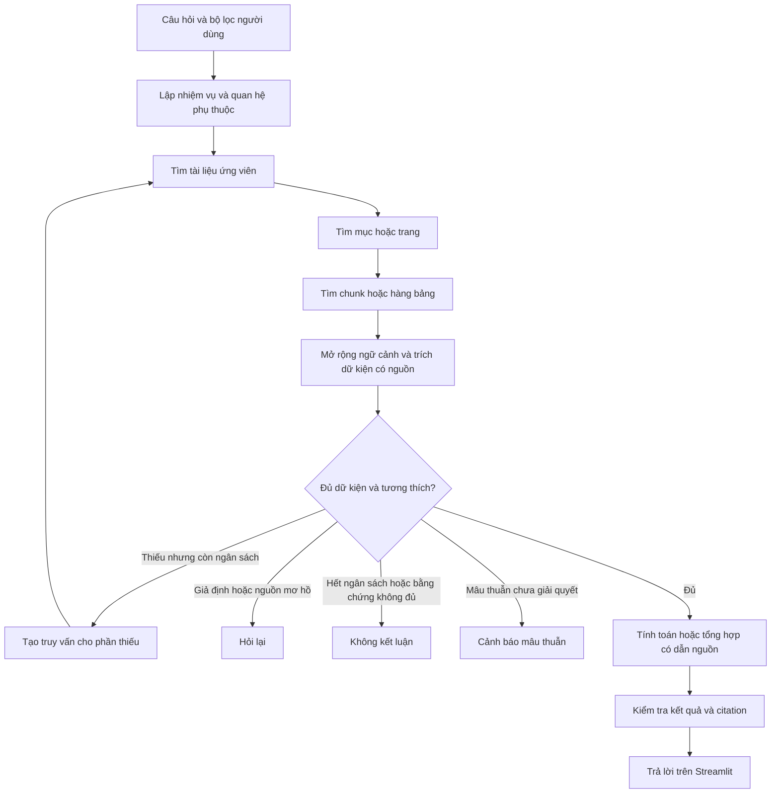

# Kế hoạch hierarchical retrieval và suy luận từ nhiều tài liệu

Ngày lập: **02/10/2026**. Trạng thái: **kế hoạch thiết kế, chưa triển khai code**.

## 1. Mục tiêu và phạm vi

Mục tiêu là nâng cấp luồng hỏi đáp Streamlit để tìm đúng tài liệu, tìm xuống nội dung chi tiết, rồi tìm tiếp bằng dữ kiện trung gian khi câu hỏi cần nhiều nguồn. Kết quả phải dẫn được về đoạn, trang hoặc ô bảng gốc; các phép tính có thể được kiểm tra lại.

Đã xác nhận với người dùng:

- Tạo kế hoạch riêng trong `docs/`.
- Kết hợp **hierarchical retrieval** với **tìm kiếm nhiều bước**.
- Dùng câu hỏi Project Jessie/Project Dawn ở phần 4 làm ví dụ xuyên suốt.
- Hỗ trợ cả nhiều trang trong cùng file và nhiều file; ví dụ BAT hiện có dùng các trang 5, 10, 11, và có thêm fixture nhiều file để kiểm thử.
- Với kịch bản BAT, mặc định **100% sản lượng bất hợp pháp bị cắt giảm chuyển thành doanh số BAT**, ghi rõ đây là giả định do người dùng chọn. Không hỏi lại giả định này khi xử lý câu mẫu.

Giả định triển khai kế thừa dự án hiện tại: Windows, GPU 6 GB, model local, Streamlit, tiếng Việt/Anh, SQLite FTS5 + Qdrant local, citation và bộ lọc nguồn hiện có. Đây là cơ sở lập kế hoạch, không phải yêu cầu nâng cấp phần cứng hoặc sử dụng API trả phí. Các giới hạn số vòng/tokens trong tài liệu là giá trị khởi điểm để thử, chưa phải số đo hay cam kết hiệu năng.

Phạm vi gồm cả **nhiều trang trong một tài liệu** và **nhiều tài liệu khác nhau**. Không yêu cầu tối thiểu hai file cho mọi câu hỏi: nếu một file đã có đủ bằng chứng thì dùng đúng file đó. Ca kiểm thử đa tài liệu phải thực sự phân bố dữ kiện trên nhiều nguồn, không lấy số lượng dự án làm số lượng tài liệu.

Kế hoạch bổ sung kiểm tra dữ kiện cần thiết và phép tính vì đây là điều kiện để suy luận nhiều nguồn hoạt động được. Nó chưa triển khai đầy đủ các tính năng khác đã bàn: điểm tin cậy được hiệu chỉnh, phát hiện mọi mâu thuẫn ngữ nghĩa hoặc phân loại mọi câu ngoài phạm vi. Vẫn cần từ chối kết luận khi thiếu dữ kiện, có mâu thuẫn chưa giải quyết hoặc hết ngân sách tìm kiếm.

## 2. Hiện trạng và phần cần thay đổi

| Thành phần hiện có | Vai trò | Khoảng trống |
|---|---|---|
| [contracts.py](../denso_a3/contracts.py) | `ChunkRecord`, `QueryPlan`, `RetrievedEvidence`, `AnswerRecord`, `RagConfig` | Chưa có node phân tầng, nhiệm vụ phụ, dữ kiện có kiểu và quan hệ phụ thuộc |
| [bt4/chunking.py](../denso_a3/bt4/chunking.py) | Chunk văn bản/bảng/ảnh; `parent_id`; `parents.json` giữ trang/bảng | Parent mới dùng để mở rộng bảng, chưa được lập chỉ mục và truy xuất theo tầng |
| [bt5/store.py](../denso_a3/bt5/store.py) | Chunk SQLite + FTS5, vector Qdrant, chung bộ lọc | Chỉ mục hiện truy xuất ở cấp chunk; chưa có node tài liệu/mục |
| [bt6/planner.py](../denso_a3/bt6/planner.py) | Phân tích intent/language/filter bằng regex | Chưa tách câu hỏi thành các nhiệm vụ có dữ kiện phụ thuộc |
| [bt6/retrieval.py](../denso_a3/bt6/retrieval.py) | Lexical + dense, RRF, rerank, bình thường lấy tối đa 5 evidence | Một lượt tìm với câu hỏi gốc; một chủ đề dễ chiếm hết top-k |
| [pipeline/rag_runner.py](../denso_a3/pipeline/rag_runner.py) | Điều phối lượt hỏi, memory, retrieval, conflict, generation | Chưa có vòng tìm kiếm bổ sung hoặc điều kiện đủ dữ kiện để tính |
| [bt7/answering.py](../denso_a3/bt7/answering.py) | Sinh đáp án và kiểm tra pointer citation | Chưa có calculator có kiểu; chưa đối chiếu đầy đủ các đầu vào suy luận |
| [evaluation/rag_evaluator.py](../denso_a3/evaluation/rag_evaluator.py) | QA/nhãn bằng chứng nháp theo một nguồn | Chưa đo khả năng lấy đủ bộ bằng chứng của một câu nhiều nguồn |

Giữ baseline hiện tại để đối chiếu. Không đồng nhất việc đã có `parent_id` với việc đã có hierarchical retrieval.

## 3. Kiến trúc đề xuất

Hai phần phối hợp nhưng có trách nhiệm khác nhau:

**Phân tầng:** xác định nơi nên tìm, sau đó tìm bằng chứng chính xác trong các nơi đó. **Nhiều bước:** xác định dữ kiện nào còn thiếu, tạo truy vấn tiếp theo từ dữ kiện đã được nguồn hỗ trợ, rồi quay lại tìm kiếm.

Thiết kế áp dụng hierarchy dựa trên cấu trúc tài liệu có sẵn, không bắt buộc dựng cây clustering xuyên toàn corpus. RAPTOR là tham khảo về retrieval ở nhiều mức trừu tượng; hệ thống này trước hết dùng các quan hệ tài liệu/mục/trang xác định được từ BT1–BT3, vì có thể audit nguồn và giữ bảng. [RAPTOR](https://arxiv.org/abs/2401.18059).

Vòng tìm tiếp tham khảo ý tưởng đan xen truy xuất và kết quả trung gian của IRCoT. Ở đây chỉ đưa tiếp dữ kiện đã gắn nguồn hoặc nhiệm vụ còn thiếu; không coi suy đoán của model là sự thật để dẫn các lượt tìm sau. Đây là phương án áp dụng cho dự án, không phải bản sao nguyên kiến trúc nghiên cứu. [IRCoT](https://aclanthology.org/2023.acl-long.557/).



### 3.1. Ba cấp chỉ mục và quan hệ parent

| Cấp | Nội dung | Công dụng |
|---|---|---|
| L0: tài liệu | Tên nguồn, các heading/chủ đề, tên thực thể được trích, synopsis ngắn, ID các mục con | Định tuyến tới nhiều tài liệu có thể đáp ứng các nhiệm vụ |
| L1: mục hoặc trang | Heading, phạm vi trang, mô tả nội dung và bảng trong mục, ID các chunk con | Khoanh vùng objectives, benefits, budgets… |
| L2: chunk | OCR văn bản, hàng/nhóm hàng bảng, figure, page_visual; giữ vị trí và chất lượng | Bằng chứng để trích dữ kiện và dẫn nguồn |

Không tạo heading hoặc ranh giới mục giả. Nếu layout chưa đủ tin cậy, L1 dùng trang vật lý. Với ảnh, L1 là ảnh và `page_number = null`. Mục dài có thể trải nhiều trang nhưng mỗi bằng chứng con phải giữ nguồn/trang riêng.

Bảng đầy đủ là parent context của chunk bảng. Không cần tạo thêm một tầng vector chỉ để biểu diễn mỗi ô. Trích số liệu vẫn cần xác định hàng, cột, đơn vị và ghi chú liên quan.

L0/L1 là **thông tin định tuyến**, không phải bằng chứng độc lập cho đáp án. Synopsis do LLM hoặc mô tả ảnh không được thay thế văn bản/ảnh gốc. Trước khi dùng bất kỳ số liệu nào trong synopsis, phải truy xuất xuống L2 và kiểm tra nguồn.

### 3.2. Tránh mất tài liệu ở tầng trên

Không chỉ lấy một tài liệu đứng đầu rồi loại mọi nguồn khác. Tìm L0 riêng cho từng nhiệm vụ, hợp nhất nhiều tài liệu ứng viên, giữ điểm/nguồn của từng nhánh. Với câu hỏi cần nhiều chủ đề, phân bổ ứng viên theo nhiệm vụ trước khi rerank.

Giữ một nhánh tìm L2 toàn phạm vi đã được phép để cứu các trường hợp synopsis không chứa thực thể quan trọng. Nhánh này có thể bổ sung tài liệu/mục vào shortlist, nhưng không nới hard filters. Điểm L0 chỉ giúp định tuyến; điểm L2 và khả năng đáp ứng nhiệm vụ quyết định bằng chứng cuối.

Nếu bridge entity dẫn sang tài liệu khác, lần tìm sau có thể mở lại L0 trên toàn phạm vi người dùng cho phép. Không mặc định giới hạn bridge trong cùng `document_family_id`: nhiều nguồn bổ sung hợp lệ có thể thuộc các họ khác nhau.

## 4. Ví dụ BAT: câu hỏi, dữ kiện và phụ thuộc

> Nếu cả hai dự án Project Jessie (Nam Phi & vùng đệm) và Project Dawn (Nigeria) đều hoàn thành 100% mục tiêu cắt giảm sản lượng thuốc lá bất hợp pháp đã đề ra, thì tổng lợi nhuận gộp (Gross Margin) tạo ra cho BAT khu vực AME là bao nhiêu? Sau khi trừ đi tổng ngân sách chi phí dự kiến (Latest Estimate) của hai dự án này, lợi nhuận ròng ước tính thu về là bao nhiêu?

### 4.1. Những gì đã tìm thấy trong index hiện tại

Đã đọc `records.sqlite` theo chế độ chỉ đọc và `parents.json` của index `.local/indexes/59f1648f8fd3`. Các dữ kiện dưới đây nằm trong **cùng file `nhwc0428.pdf`**, không phải hai file Jessie/Dawn riêng:

| Vị trí | Nội dung trong artifact đã đọc | Ý nghĩa cho thiết kế |
|---|---|---|
| Trang 5 | Jessie: mục tiêu 600 triệu sticks; Dawn: 620 triệu sticks | Cần lấy đúng từng dự án, không lấy tổng mục tiêu của cả chương trình hoặc dự án khác |
| Trang 10 | AME Gross Margin: GBP 8,6 per mille; 100 triệu sticks tương ứng GBP 860k, theo 2007 budget | Có bridge từ mục tiêu sản lượng sang hệ số tài chính của AME; cần đơn vị và kỳ tính |
| Trang 11 | Latest Estimate: Jessie GBP 469.000; Dawn GBP 1.103.000; còn có cột Co plan 2006, Variance và chú thích USD | Cần chọn đúng cột; tránh đếm cả GBP và USD như hai khoản khác nhau |
| Trang 5, chú thích | Nêu giới hạn trong việc quy toàn bộ volume gain cho tác động chống thuốc lá bất hợp pháp | Cắt giảm illicit volume và tăng doanh số BAT không được tự động coi là một đại lượng |

Đây là ghi nhận từ OCR/table artifacts, **chưa phải đáp án được kiểm chứng từ ảnh và chưa phải QA đã chạy model**. Khi tạo bộ kiểm thử chính thức, phải soát các trang gốc, ô bảng, đơn vị và giả định; không lấy caption `unverified` làm gold.

### 4.2. Tách thành nhiệm vụ có thể kiểm tra

| ID | Nhiệm vụ | Dữ kiện cần | Phụ thuộc |
|---|---|---|---|
| T1 | Xác định mục tiêu Jessie đúng phạm vi BATSA/vùng đệm | `V_J`, loại sản lượng, thời hạn, citation | Không |
| T2 | Xác định mục tiêu Dawn/Nigeria | `V_D`, loại sản lượng, thời hạn, citation | Không |
| T3 | Tìm hệ số tính Gross Margin cho AME và áp dụng giả định đã chốt | Hệ số `r`, mẫu số đơn vị `d`, kỳ tính; `a_J = a_D = 1` từ giả định người dùng | Các thực thể và đại lượng của T1/T2 |
| T4 | Tìm ngân sách Latest Estimate Jessie | `C_J`, tiền tệ, cột, kỳ/phạm vi chi phí, citation | Nhận diện Jessie |
| T5 | Tìm ngân sách Latest Estimate Dawn | `C_D`, tiền tệ, cột, kỳ/phạm vi chi phí, citation | Nhận diện Dawn |
| T6 | Kiểm tra tương thích và tính hai kết quả | Các dữ kiện trên và giả định hợp lệ | T1–T5 |

`a_J`/`a_D` là hệ số chuyển sản lượng cắt giảm thành sản lượng BAT thu được. Với câu BAT này, **cả hai bằng 1 theo xác nhận của người dùng**, lưu `origin = user_instruction`; đây là điều kiện giả định cho phép tính, không phải số liệu được tài liệu chứng minh. Không cần tìm tiếp để xác nhận lại hai hệ số này. Với câu khác, chỉ áp dụng nếu có cùng giả định đã được chỉ định; không âm thầm áp dụng cho mọi bài toán kinh tế. Không cần tìm riêng một hệ số nếu tài liệu đã nêu trực tiếp Gross Margin tại mục tiêu 100%, với phạm vi và giả định phù hợp.

Không yêu cầu mỗi nhiệm vụ phải do một file khác nhau trả lời. Ví dụ này có thể lấy T1/T2 từ trang 5, T3 từ trang 10 và T4/T5 từ cùng bảng trang 11. Ca nhiều file dùng cùng kế hoạch nhiệm vụ nhưng các evidence có `document_id` khác nhau.

### 4.3. Minh họa các lượt tìm

**Lượt đầu:** tìm tài liệu theo Project Jessie/Dawn và AME; xuống mục objectives và budgets. Tìm được mục tiêu, đúng thực thể và cột Latest Estimate, nhưng có thể chưa biết hệ số Gross Margin.

**Lượt sau:** từ dữ kiện đã tìm, tạo truy vấn như `AME gross margin per mille 2007 budget` hoặc `AME gross margin per 100 million sticks`. Tìm lại L0, sau đó xuống Benefits Realisation. Không mang giá trị tài chính tự đoán vào truy vấn như thể đã có nguồn.

**Lượt kiểm tra phần thiếu:** kiểm tra phạm vi, kỳ tính, đơn vị và chú thích còn chưa rõ. Với câu BAT, quy tắc chuyển volume đã được người dùng chốt nên không trở thành task thiếu. Không tiếp tục tìm những dữ kiện đã đủ; không lặp lại truy vấn giống hệt mà không có mục tiêu mới.

Nếu thiếu thông tin chỉ người dùng có thể quyết định, trả `clarification`. Nếu nguồn thiếu sau khi hết giới hạn tìm, trả `abstain` kèm danh sách đầu vào còn thiếu. Hoàn thành 100% mục tiêu là điều kiện của câu hỏi, không phải bằng chứng rằng các dự án đã hoàn thành ngoài thực tế.

### 4.4. Công thức và cách kiểm chứng

Nếu dùng hệ số GBP `r` cho `d` sticks và có căn cứ cho `a_J`, `a_D`:

```text
BAT_volume_J = V_J × a_J
BAT_volume_D = V_D × a_D
GrossMargin_total = (BAT_volume_J + BAT_volume_D) / d × r
LatestEstimate_total = C_J + C_D
Net_estimate = GrossMargin_total - LatestEstimate_total
```

Với giả định BAT đã chốt, `a_J = a_D = 1`, nên công thức rút gọn là `GrossMargin_total = (V_J + V_D) / d × r`. Phần trả lời phải nêu: **“Theo giả định toàn bộ sản lượng cắt giảm chuyển thành doanh số BAT…”**, trước khi trình bày kết quả. Nếu tài liệu đưa cảnh báo về việc quy đổi volume, ghi nhận cảnh báo đó cùng với giả định; không diễn giải kịch bản giả định thành dự báo doanh số chắc chắn.

Nếu nguồn đưa trực tiếp Gross Margin của từng dự án tại mục tiêu này, dùng tổng hai giá trị trực tiếp, tránh nhân hệ số lần nữa. Không chọn lẫn hai cách tính hoặc đếm cùng lợi ích hai lần.

Tính bằng `Decimal` và phép toán có danh sách cho phép, không để LLM tự tính số cuối hoặc thực thi chuỗi biểu thức tùy ý. `per mille` là trên 1.000 sticks; `million`, `k`, dấu phân cách số và đồng tiền phải được parse có ngữ cảnh. GBP và USD ghi trong cùng ô có thể là hai cách biểu diễn cùng ngân sách; không cộng hai biểu diễn đó.

Kết quả “ròng” ở đây là phép trừ **Gross Margin – Latest Estimate** theo câu hỏi. UI cần nêu đúng phép tính và những giả định được dùng; không mở rộng sang các khoản chi phí/thuế mà câu hỏi và nguồn không cung cấp. Nếu kỳ hoặc phạm vi chi phí chưa tương thích, phải làm rõ trước khi gắn kết quả với một kỳ cụ thể.

Không đưa đáp án số cuối vào kế hoạch này: việc hiện tại là thiết kế cơ chế, không trả lời QA tài chính hoặc chứng nhận các số OCR.

## 5. Dữ liệu và contract cần bổ sung

Định nghĩa các contract chung trong `denso_a3/contracts.py`; giữ logic nghiệp vụ ở BT tương ứng.

| Contract đề xuất | Trường chính | Điều kiện bắt buộc |
|---|---|---|
| `HierarchyNode` | `node_id`, `level`, `document_id`, `parent_node_id`, `heading`, `page_ids`, `routing_text`, `origin`, `quality_flags` | Node thuộc một tài liệu; summary có provenance, không có citation giả |
| `HierarchyLink` | `parent_node_id`, `child_node_id` hoặc `chunk_id`, `source_sha256` | Không có orphan/cycle; trỏ tới đúng snapshot nguồn |
| `ResearchTask` | `task_id`, `query`, `required_fields`, `depends_on`, `status`, `unresolved_inputs` | Không tạo truy vấn phụ thuộc từ một giá trị chưa được hỗ trợ |
| `EvidenceFact` | `fact_id`, `task_id`, `entity`, `metric`, `value`, `unit`, `scale`, `period`, `scenario`, `scope`, `evidence_refs`, `origin` | Citation tới chunk/page/ô bảng; giữ raw value để audit |
| `AssumptionRecord` | `key`, `value`, `origin`, `source_refs`, `confirmation_status` | Phân biệt giả định của câu hỏi, tài liệu, người dùng và phần chưa xác nhận |
| `EvidenceCoverage` | Từng nhiệm vụ: `supported`, `missing`, `ambiguous`, `conflicting`; lý do | Đủ đầu vào theo kế hoạch, không diễn giải thành xác suất đúng |
| `CalculationRecord` | Phép toán, typed operands, kết quả, đơn vị, nguồn đầu vào | Tất cả toán hạng có nguồn hoặc giả định rõ; kiểm tra phép tính/đơn vị |

`AnswerRecord` thêm trường tùy chọn hoặc mở rộng trace để giữ tasks, coverage, facts, calculations, stop_reason, tài liệu đã tìm và số vòng. Giữ các trường hiện hữu để UI/memory không mất tương thích. Chỉ thêm field được serialize có giới hạn; không lưu lặp toàn bộ corpus trong mỗi turn.

Mã evidence `E1...En` được cấp từ danh mục hợp nhất cuối. Dữ kiện trung gian dùng ID nguồn ổn định (`chunk_id`, page/cell refs), tránh đổi E1 ở mỗi lượt rồi làm citation trỏ nhầm.

Quan hệ parent mở rộng từ trang/bảng phải trả cả các chunk gốc có nội dung bổ sung. Nếu số liệu nằm trong parent nhưng ngoài child đầu tiên, citation phải trỏ tới chunk/ô chứa số đó; không gán mọi nội dung parent cho bbox của child.

## 6. Lưu trữ và xây index

### 6.1. Artifact của snapshot mới

```text
<index mới>/
  manifest.json                 # có hierarchy_version, count, provenance, fingerprint
  documents.json, pages.json
  registry.json, chunks.json, parents.json
  records.sqlite                # chunks + text_index như hiện tại
  hierarchy.sqlite              # nodes, links, node FTS, liên kết tới leaf
  hierarchy.json                # export/audit, không bắt buộc nạp toàn bộ cho mỗi query
  vectors/
    ...                         # Qdrant local, collections chunks và routing_nodes
  assets/, sources/
```

Dùng **một QdrantClient cho cả hai collection** trong một lượt hoặc một build. Không mở hai client local cùng path, vì khóa Qdrant hiện chỉ cho một instance truy cập. L0/L1 được lọc theo `level` và descendant scope; L2 vẫn dùng collection `chunks`.

Snapshot build tạo trong staging rồi chuyển sang `ready` và rename khi đủ dữ liệu. Giữ hash/version của hierarchy policy, tokenizer/embedding, prompt nếu có summary LLM, và nguồn BT1–BT3. Build không được đọc nhãn QA, đáp án hoặc fixture gold để tạo summary/index.

### 6.2. Cách tạo nội dung định tuyến

1. Lấy inventory nguồn/trang và layout BT3 đã hoàn tất; giữ trạng thái partial/quality.
2. Tạo mục từ heading và reading order có provenance; fallback theo trang nếu không xác định được mục.
3. Liên kết mọi chunk có thể index với L1 và L0, gồm cả table/figure/page_visual.
4. Tạo synopsis **trích xuất** ban đầu: heading, tiêu đề bảng/cột, tên thực thể và các đoạn đại diện dưới ngân sách tokens. Giữ danh sách thực thể/chủ đề riêng để những tên bị synopsis rút gọn vẫn tìm được bằng lexical.
5. Embed routing text bằng encoder hiện có; embed leaf theo chính sách hiện tại. L0/L1 dài phải được chia/window rõ ràng hoặc rút gọn có provenance; không trông chờ tokenizer âm thầm cắt phần cuối.
6. Tùy chọn summary LLM được đánh giá sau baseline trích xuất; cache theo source/policy/model hash, luôn gắn `derived`. Summary không quyết định revision authority.

Không bắt buộc OCR lại để nâng cấp hierarchy khi artifact nguồn hiện có hợp lệ. Lần triển khai vẫn phải tạo snapshot index mới. Nếu tái sử dụng vector leaf, phải khớp content key, embedding model/dimension và chunk policy; nếu không, re-embed. Không sửa index đang được UI sử dụng.

### 6.3. Filter và update metadata

Bộ lọc gốc của người dùng áp dụng ở **mọi tầng và mọi vòng**. Descendant đủ điều kiện được xác định trước giới hạn top-k. Node cha không được dùng để đưa lại chunk/page đã bị loại vào prompt.

Nếu một node chứa cả trang được phép và trang bị loại, dùng routing view từ các descendant được phép, thay vì dùng summary trộn để trích dữ kiện hoặc hiển thị. Khi khó tạo view chính xác, fallback xuống các leaf đã lọc. Hard filters nghiệp vụ vẫn chỉ dùng metadata verified; thực thể suy ra từ văn bản phục vụ routing/ưu tiên, không tự nâng thành metadata đã xác minh.

`rag-metadata` phải refresh hierarchy metadata/payload/fingerprint theo snapshot mới. Nếu routing text chứa metadata đã sửa thì cập nhật cả text và vector liên quan; nếu chỉ sửa payload không làm text thay đổi thì không cần re-embed. Nguồn nội dung đổi phải rebuild, không giả làm metadata update.

## 7. Luồng xử lý câu hỏi chi tiết

1. **Chuẩn hóa và scope:** kiểm tra index/config, áp dụng memory rewrite nếu cần; giữ câu hỏi gốc và filters bất biến. Lịch sử hội thoại không là bằng chứng.
2. **Lập nhiệm vụ:** model local trả JSON có schema gồm thực thể, mục tiêu, nhiệm vụ phụ, dữ kiện cần và dependency. Validator giới hạn số nhiệm vụ, kiểm tra cycle, không cho model thay bộ lọc hoặc tự điền đáp án. Parse lỗi thì sửa một lần có giới hạn hoặc trả lỗi rõ; không im lặng đổi sang câu hỏi đơn giản hơn.
3. **Truy xuất theo tầng:** chạy L0/L1/L2 cho nhiệm vụ đã có đủ đầu vào; batch các truy vấn độc lập trong cùng phase model. Giữ nhánh L2 toàn scope để giảm bỏ sót ở tầng cha.
4. **Rerank và chọn bằng chứng:** kết hợp độ liên quan với phần dữ kiện nhiệm vụ chưa có; loại trùng nhưng giữ các occurrence/source phù hợp. Không để một tài liệu chiếm toàn context khi nhiệm vụ khác còn thiếu.
5. **Mở rộng parent và trích facts:** lấy đúng heading/bảng/chú thích; trích dữ kiện theo schema, kiểm tra raw span/cell và đại lượng. OCR khó đọc hoặc ô cần thiết thiếu → không tự sửa thành số mong muốn; có thể route sang ảnh/crop hiện có để kiểm tra và lưu origin visual.
6. **Đánh giá coverage:** facts đúng thực thể, metric, đơn vị, kỳ/scenario? Có căn cứ nối các nguồn? Có mâu thuẫn liên quan? Giả định nào chưa được xác nhận? Kết quả là trạng thái và danh sách phần thiếu, không phải điểm tự tin model tự chấm.
7. **Tìm tiếp:** tạo query từ task chưa đủ và bridge fact có nguồn; mở rộng tài liệu/mục trong scope. Cache truy vấn trong RAM theo scope/query/index hash, tránh chạy lặp vô ích.
8. **Kết thúc:** đủ thì tính/tổng hợp; ambiguity cần lựa chọn người dùng thì clarification; conflict chưa giải quyết thì cảnh báo; hết ngân sách mà thiếu thì abstain. Không ép đủ số vòng khi đã đủ ở lượt đầu.
9. **Kiểm tra và trả lời:** citation bao phủ đầu vào/phép tính, số liệu khớp calculator, ngôn ngữ đúng, không dùng giá trị chỉ xuất hiện trong summary hoặc answer cũ. Nếu sửa một lần vẫn sai, không phát hành đáp án khẳng định.

Ngữ cảnh trả lời được chọn theo **ngân sách tokens và coverage**, không chỉ lấy 5 chunk cuối. Có thể cần hơn 5 evidence cho nhiều nhiệm vụ nhưng vẫn phải vừa context của model. Nếu không thể đóng gói đủ bằng chứng, dùng fact ledger gọn có raw excerpts và nguồn, chia kiểm tra theo nhiệm vụ; không cắt mất một toán hạng rồi trả kết quả.

## 8. Điều kiện dừng, mâu thuẫn và độ tin cậy

| Tình trạng | Hành động |
|---|---|
| Đủ mọi dữ kiện bắt buộc, bridge/giả định rõ, đầu vào tương thích | Tính hoặc tổng hợp, kiểm tra rồi trả lời |
| Thiếu một dữ kiện và có truy vấn bổ sung cụ thể | Tìm tiếp trong ngân sách |
| Chưa rõ kỳ, bản tài liệu, điều kiện chuyển đổi hoặc phạm vi | Hỏi lại để người dùng chọn/xác nhận |
| Giá trị trái nhau trong cùng ngữ cảnh mà chưa rõ nguồn có hiệu lực | `conflict`, không chọn đại một nguồn |
| Không có fact mới và không còn hướng tìm hữu ích | Dừng sớm với phần thiếu |
| Hết vòng, hết thời gian, hết số lượt hoặc quá context | `abstain`; trace nêu giới hạn cụ thể |

Conflict gate hiện có tiếp tục được dùng với các điều kiện metadata của nó. Đối với fact ledger mới, kiểm tra bất đồng của cùng metric/entity/scenario/period trong những nguồn đã lấy; không coi số khác nhau ở hai kỳ là mâu thuẫn. Gate cũ không phát hiện tiền tệ hay phần lớn quan hệ nghiệp vụ của ví dụ BAT, nên không được dùng làm bằng chứng rằng tất cả đầu vào tài chính đã nhất quán.

“Đủ” nghĩa là đủ đầu vào cho các nhiệm vụ đã xác định và đã kiểm tra, không chứng minh rằng toàn corpus không còn nguồn phản bác hoặc model không bỏ sót nhiệm vụ. Vì vậy không thêm trường “confidence 98%” tự chấm. Điểm tin cậy được hiệu chỉnh là một hạng mục khác, cần dữ liệu kiểm duyệt và benchmark riêng.

## 9. Module và hàm dự kiến

Các tên dưới đây là **đề xuất khi triển khai**, chưa tồn tại trong code.

| File | Hàm/trách nhiệm dự kiến | Input → output |
|---|---|---|
| `denso_a3/bt4/hierarchy.py` mới | `build_hierarchy` | Run/chunks/parents → nodes, links, routing views; báo orphan/cycle/nguồn sai |
| `denso_a3/bt5/hierarchy_store.py` mới | Thêm/tìm node, children, filtered descendants | Node/vector/filter → routing hits; dùng Qdrant client chia sẻ từ store |
| `denso_a3/bt6/task_planner.py` mới | `build_research_plan` | Question + scope → validated tasks/dependencies/assumptions |
| `denso_a3/bt6/hierarchical_retrieval.py` mới | `retrieve_hierarchical` | Task/query/filter → leaf evidence, route trace |
| `denso_a3/bt6/evidence_coverage.py` mới | `check_coverage` | Tasks/facts/assumptions → ready/missing/ambiguous/conflicting |
| `denso_a3/bt7/fact_extraction.py` mới | Trích và kiểm tra typed facts | Evidence/schema → facts có provenance hoặc unresolved inputs |
| `denso_a3/bt7/calculation.py` mới | `calculate` | Typed operands + operation → Decimal result + units + input refs |
| `denso_a3/pipeline/research_runner.py` mới | Điều phối vòng tìm/tính; quản lý budgets | Question/index/config/scope → result/trace; không phụ trách SQL hoặc model adapter |
| `denso_a3/pipeline/index_builder.py` sửa | Build hierarchy và snapshot, metadata update | Run → index có capability hierarchy |
| `denso_a3/pipeline/rag_runner.py` sửa | Dispatch baseline hoặc luồng research | Giữ API `ask` cho UI/CLI; memory được append một lần ở kết quả cuối |
| `denso_a3/backends/` | Mở rộng quản lý vòng đời model và token counting khi cần | Model phases có context manager, cleanup cả lỗi/timeout |
| `denso_a3/ui/app.py`, `pipeline/rag_cli.py` sửa | Chọn chế độ, trình bày trace/clarification | Không chứa thuật toán retrieval hoặc tính tài chính |
| `denso_a3/evaluation/multidoc_evaluator.py` mới | Đánh giá bộ câu nhiều nguồn | Gold được soát + results → coverage/accuracy/citation/latency metrics |

Entry point giữ `__main__ → pipeline.cli → pipeline.rag_cli`. Trong UI, `ask()` vẫn là API chính. Luồng mới được chọn bằng cấu hình orchestration riêng; `strategy` lexical/dense/hybrid/visual tiếp tục mô tả nhánh retrieval. Không dùng thêm một giá trị strategy để nhập nhằng “hierarchical” với “dense”.

## 10. Model, ngân sách và Streamlit

Giữ BGE-M3, reranker và Qwen local làm điểm xuất phát; chưa chứng minh Qwen 2B đủ ổn định cho planner/fact extraction. Cần benchmark model thật trước khi quyết định đạt yêu cầu. Không chọn model/API mới chỉ từ kết quả nghiên cứu trên dữ liệu khác.

Với GPU 6 GB, chạy tuần tự theo phase: planner LLM → đóng LLM → batch embedding/rerank → đóng model retrieval → fact extraction/check LLM → đóng hoặc trả lời ngay nếu đã đủ. Những lượt sau làm tương tự; không giữ đồng thời mọi weights trên GPU. Reuse cùng model trong một phase và cache query vectors trong RAM để giảm reload. Hỏi nhiều vòng làm tăng latency; cần đo cả cold model load và peak VRAM.

Giá trị khởi điểm đề xuất: tối đa 6 nhiệm vụ, 3 vòng, 12 lượt truy xuất logic theo nhiệm vụ, tối đa 6 tài liệu ứng viên/nhiệm vụ và 4 mục/tài liệu trước leaf rerank. Đây là giới hạn mềm để thử; escape search và node visits cũng phải có ngân sách riêng, không được vô hạn. Toàn query có deadline cấu hình, phân biệt với timeout HTTP/server của từng model call; benchmark xác định deadline phù hợp trước rollout.

Ngân sách prompt dùng tokenizer đúng của generation runtime; không lấy `3.500 ký tự` hoặc tokenizer BGE thay cho số tokens của Qwen. Context 8.192 hiện có cần dự phòng system/schema, câu hỏi, câu trả lời và ảnh. Nếu chưa có tokenizer/API đếm tokens tương thích, dùng guard bảo thủ và nêu đây là phần cần xác minh, không giả định mọi prompt đều vừa.

UI phổ thông hiển thị tiến độ ngắn: đang tìm nguồn, kiểm tra dữ kiện, tìm bổ sung, tính kết quả. Kết quả có bảng đầu vào, công thức nếu cần và citation. Chi tiết tasks/routes/scores/budgets nằm trong expander, không bắt người dùng hiểu backend trước khi hỏi.

Clarification phải thực sự nối lại được yêu cầu: lưu `pending_research` trong session ở chế độ tức thì, có question, scope/index fingerprint, tasks/facts và phần cần xác nhận. Phản hồi được gắn với pending state để tiếp tục hoặc làm lại nhiệm vụ cần thiết. Đổi index/filter làm state cũ không còn hợp lệ. Dài hạn có bản ghi clarification và trạng thái chờ có version; không chỉ dựa vào LLM rewrite câu “đúng” hoặc “tính toàn bộ” để hiểu lần hỏi trước.

Giữ nguyên semantics lưu trữ: tức thì không tự ghi file trace/hỏi đáp; dài hạn lưu kết quả/trạng thái hội thoại theo chính sách memory. CLI chỉ xuất JSON khi có `--output`. Snapshot index chỉ được tạo khi build/migrate; câu hỏi không thêm vector vào index.

## 11. Kế hoạch triển khai theo giai đoạn

| Giai đoạn | Việc làm | Điều kiện hoàn thành |
|---|---|---|
| P0 — Đặc tả và gold | Ghi nhận giả định BAT đã xác nhận; soát trang 5/10/11; tạo tasks/gold evidence, ca nhiều file độc lập | Có expected outcome cho đủ nguồn, thiếu nguồn và dữ kiện khác cần clarification |
| P1 — Hierarchy offline | Contract, graph tài liệu/mục/chunk, routing text, SQLite/Qdrant node index, snapshot validation | Không orphan/cycle, leaf coverage đầy đủ, filter đúng; baseline còn chạy |
| P2 — Retrieval theo tầng | L0/L1/L2, nhiều tài liệu/nhiệm vụ, escape branch, trace, parent expansion | Lấy đủ bộ evidence tốt hơn baseline trên các ca khó mà không mất scope |
| P3 — Tìm nhiều bước | Planner schema, tasks/dependencies, fact ledger, coverage, query bổ sung, budgets/stop | Lấy được bridge fact từ nguồn và tới được tài liệu tiếp theo; thiếu thì dừng đúng |
| P4 — Suy luận và phép tính | Calculator, assumptions, validation số/citation, kiểm tra kỳ/đơn vị, clarification resume | BAT dùng đúng giả định đã chốt; công thức kiểm chứng được, không tự điền toán hạng thiếu |
| P5 — Tích hợp và migration | UI/CLI/config, model lifecycle, legacy manifest, metadata update, memory | Chạy từ UI/CLI, giữ instant/long-term, index cũ không bị ghi đè |
| P6 — Benchmark và rollout | So sánh A/B/C, sửa failure modes, pilot rồi mới mặc định | Chất lượng/latency/VRAM có số đo thật, tiêu chí dưới đây đạt, README phản ánh luồng mới |

Dependency chính: P0 → P1 → P2 → P3 → P4 → P5 → P6. Có thể viết đặc tả UI sớm nhưng chỉ bật đường mới sau khi contract/runtime được kiểm chứng. Không đặt thời hạn hoàn thành từ kế hoạch RAG cũ nếu chưa xác nhận lại khối lượng và benchmark.

## 12. Kiểm thử và tiêu chí chấp nhận

### 12.1. Bộ ca cần có

| Ca | Kết quả cần kiểm tra |
|---|---|
| BAT đúng nguồn và giả định rõ | Đủ mục tiêu/hệ số/cost, đúng cột Latest Estimate, công thức và citation cho mỗi đầu vào |
| BAT với giả định 100% chuyển thành doanh số đã được người dùng chốt | Dùng `a_J = a_D = 1`, nêu rõ giả định; không hỏi lại và không giả gắn citation tài liệu cho giả định |
| Câu khác thiếu quy tắc chuyển đổi và chưa có giả định của người dùng | Clarification hoặc kết luận có điều kiện đã được cho phép; không tự đặt hệ số |
| Cùng dữ kiện BAT được tách sang nhiều file fixture có manifest riêng | Lấy đủ evidence từ nhiều `document_id`; không hardcode tên file hoặc page number |
| Bridge case A chỉ nêu dự án/thiết bị, B chỉ nêu mã trung gian và thông số | Tạo truy vấn lượt sau từ bridge fact được A hỗ trợ, tìm B dù câu hỏi gốc không nhắc mã |
| Thiếu tài liệu hệ số hoặc ngân sách | Nêu chính xác task thiếu; không dựng số hoặc coi chi phí là 0 |
| Distractor nhiều dự án, nhiều cột và nhiều kỳ | Không lấy Harmony/Paige/Ebony, Co plan hoặc Variance thay input của câu hỏi |
| GBP và USD cùng ô, per mille/million, tỷ giá và kỳ khác nhau | Không cộng hai biểu diễn; kiểm tra dimension/period và hỏi lại khi cần |
| Hai version đưa giá trị khác nhau | Conflict hoặc chọn theo authority được xác minh, không chọn theo mtime/similarity |
| User filter loại nguồn cần thiết | Giữ filter, báo thiếu; không tìm lọt qua summary/escape/parent |
| Synopsis bỏ sót tên hoặc mô tả sai | Nhánh leaf cứu được truy xuất; không dùng số summary-only làm evidence |
| OCR sai số, ô bảng liên quan missing/merged | Kiểm tra ảnh khi khả thi, giữ provenance; unreadable thì dừng, không sửa theo gold |
| Vòng tìm lặp, task cycle, timeout, model lỗi | Dừng có stop_reason, giải phóng model và khóa index; không để query chạy vô hạn |
| Instant/long-term, clarification resume | Lưu đúng chế độ, tiếp tục đúng scope, không dùng answer cũ làm evidence |

### 12.2. Cách đánh giá

So sánh trên cùng corpus/scope/gold và ngân sách context: **A** retrieval hiện tại; **B** hierarchical một lượt; **C** hierarchical + nhiều bước + fact/calculation gate. Thêm ablation bỏ escape branch và bỏ task-balanced selection để xác định lợi ích thực của từng phần.

- **Required-evidence-set recall:** tỷ lệ câu lấy đủ một bộ bằng chứng hợp lệ để trả lời; một hit đơn lẻ không đủ. Gold có thể chấp nhận nhiều bộ nguồn tương đương.
- **Task coverage chính xác:** coverage mà hệ thống báo so với annotation người soát; không dùng tỷ lệ task do LLM tự chia làm metric duy nhất.
- **Answer/calculation accuracy:** kết luận, typed operands, công thức, đơn vị, phép tính và rounding khớp gold.
- **Citation support:** mỗi đầu vào/khẳng định được nguồn thực sự hỗ trợ; pointer validity là phép kiểm riêng.
- **Missing-evidence handling:** có từ chối/hỏi lại đúng khi cố ý bỏ tài liệu hoặc assumption không đủ.
- **Chi phí thực thi:** số lượt retrieval/model, node visits, input/output tokens, cold/warm P50/P95, peak VRAM, dung lượng và thời gian build.

Mức nghiệm thu chức năng: toàn bộ ca regression quan trọng phải qua; không có vi phạm hard filters hoặc citation tới số liệu không được cấp; các ca thiếu đầu vào không phát hành phép tính khẳng định. Bộ BAT có assumptions rõ và số được soát phải tính đúng và dẫn đầy đủ nguồn. Với đánh giá tập rộng, mục tiêu cải thiện recall/accuracy và giới hạn latency cần được chốt sau pilot; báo rõ kích thước tập, interval và failure cases, không suy rộng từ một ví dụ.

Unit/integration dùng fixture kiểm soát để kiểm tra graph/filter/calculator/budgets; kiểm thử model thật riêng cho planner/retrieval/extraction/answer và GPU. Không gọi tests mock là bằng chứng năng lực suy luận thật.

## 13. Tương thích, rollout và rủi ro

Đề xuất index RAG mới schema `1.1` với `hierarchy_version`; extraction schema BT1–BT3 giữ riêng. Sửa kiểm tra phiên bản hiện đang yêu cầu chính xác `1.0` ở `ask`: index `1.0` chạy baseline, `1.1` có hierarchy mới chạy chế độ mới. Người dùng chọn hierarchical với index thiếu capability phải nhận thông báo rebuild/upgrade, không âm thầm chạy baseline rồi gắn nhãn hierarchical.

Giữ cả hai snapshot để so sánh/rollback; chỉ kích hoạt index mới khi ready và được kiểm chứng. Khi triển khai thực, cập nhật README về entry point, build artifacts, config, luồng hỏi nhiều bước, errors/side effects và hạn chế đo được. Việc hiện tại chỉ tạo file kế hoạch nên không sửa README hoặc các module.

Rủi ro chính: synopsis mất chi tiết; L0 loại nhầm tài liệu; model nhỏ phân rã sai hoặc bịa bridge; OCR làm sai toán hạng; dữ kiện khác kỳ/điều kiện bị ghép nhầm; nhiều lượt reload làm chậm; parent context làm tràn tokens; fact gate đánh giá “đủ” khi còn bỏ sót. Các biện pháp trong kế hoạch giảm những lỗi này nhưng phải được xác minh bằng benchmark.

Thứ tự ưu tiên khi triển khai là **giữ nguồn và filter → lấy đủ dữ kiện → phép tính đúng → cải thiện tốc độ**. Hierarchical retrieval là công cụ tìm bằng chứng; không tự chứng minh đáp án đúng và không tạo ra bảo đảm “98%”.
