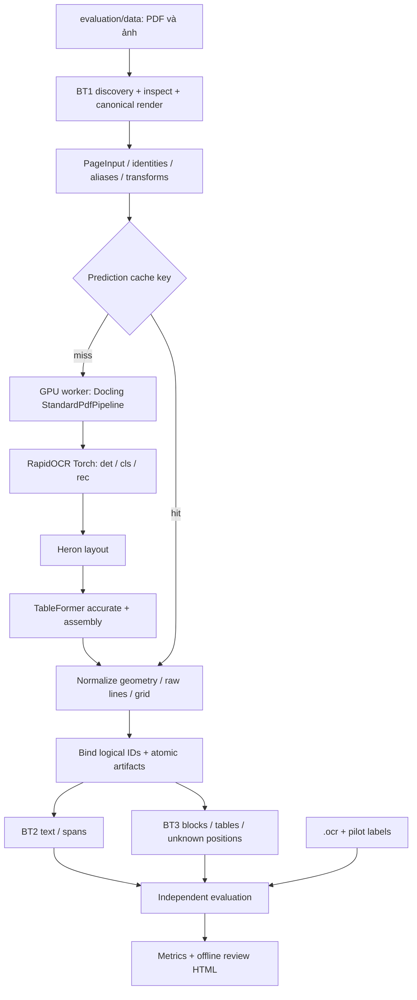

# Báo cáo triển khai Denso demo — BT1 / BT2 / BT3

Ngày kiểm chứng: **26/09/2026**. Kế hoạch gốc: [BT1–BT3 Ingestion/Extraction](BT1_BT2_BT3_Ingestion_Extraction_Plan.md). Hướng dẫn chạy hiện tại: [README dự án](../README.md).

## Kết quả chính và phạm vi kết luận

Tại thời điểm kiểm chứng, mã được triển khai trong package riêng `D:\Denso\project\denso_demo` và chạy thật trên toàn bộ dữ liệu. Vị trí `denso_demo` là lịch sử; mã BT1–BT3 hiện nằm ở gốc dự án, trong `denso_a3/`. OCR, layout và table models đều được kiểm tra weights ở **CUDA:0** trên RTX 4050 Laptop; không chuyển OCR sang CPU. Dataset gốc và kết quả baseline vẫn giữ nguyên.

- BT1: 51 nguồn, 67 logical pages/ảnh, 47 canonical images độc lập; 20 alias được giữ đầy đủ identity.
- BT2: có text cho 67/67 record, không có lỗi thực thi; 17 trang PDF được chấm bằng `.ocr`, 50 ảnh chưa có transcript → N/A.
- BT3: 60 trang `ok`, 7 trang `partial` do vị trí grid thiếu. Có 36 bảng theo logical records, tương ứng 19 bảng trên unique pages.
- Table pilot: đúng 8/8 vùng bảng và 8/8 số hàng/cột; **không hoàn chỉnh cấu trúc ô**. Bảng Project Controls có 19/20 ô có chữ khớp và thiếu 12/12 ô trống.
- Text toàn PDF: whitespace CER **10,79%**, WER **17,89%** so với bản `.ocr` chưa được soát. **Chưa thể kết luận OCR đủ chính xác để sử dụng không review.**
- 19 test demo và 7 test baseline đã qua. Hai lượt full inference/cache trả predictions giống nhau.

`ok` là trạng thái thực thi/schema, không phải “OCR đọc đúng”. Đối chiếu ảnh gốc trang 4 cho thấy có dòng chữ rõ nhưng prediction đọc sai. Điểm thấp ở một số cell cũng không bù được việc thiếu ô hoặc sai thứ tự text.

## Các quyết định đã được làm rõ

| Nội dung | Lựa chọn của người dùng / phạm vi đã áp dụng |
|---|---|
| Định dạng deliverable tại thời điểm kiểm chứng | Package `denso_demo` độc lập và báo cáo file |
| Kiến trúc | C: Docling joint OCR/layout/table |
| Phần cứng | Ưu tiên GPU, được cài thêm runtime GPU |
| Chính sách fallback | Thử cả ba trên GPU; phải hỏi trước khi đổi OCR sang CPU |
| BT3 reference | Bổ sung nhãn pilot nhìn từ source, đánh dấu agent và cần user review |
| Model download | Được xác nhận tải tiếp sau lỗi kết nối / lần từ chối quyền mạng |
| Ô trống bị thiếu | Giữ trong phạm vi kế hoạch: `unknown` và `partial`. Đã hỏi về khả năng mở rộng bước xác nhận ô trống từ ảnh; bước mở rộng chưa được bật |

DPI mặc định 200 được giữ sau benchmark dev 200/300; 300 không cải thiện pilot. Threads=4, batch model=1, một GPU worker, page deadline=180s, model startup deadline=600s. Không chạy nhiều worker tranh cùng GPU 6 GB.

## Kiến trúc thực tế



Thư viện dùng `docling-slim` 2.130.0 với extra PDF, local models, RapidOCR và extract core, cung cấp cùng namespace/API `docling`. ImageFormatOption vẫn gọi StandardPdfPipeline. Mỗi trang được đưa vào converter dưới dạng **PNG**, không đưa PDF có hidden text vào converter. Vì thế C dùng cùng OCR cho cả ảnh cũ và PDF scan, tránh một bài chấm bị “đẹp” do lấy lại text layer trước đó.

Ưu điểm thực tế: cùng page frame cho OCR/layout/table, một conversion joint, provenance và raw engine result được giữ, dễ review bảng. Hạn chế đã thấy: OCR line dài có lỗi, recognizer có thể nối text qua ranh giới cột, engine bỏ ô không có chữ; C không tự chứng minh correct reading order hoặc semantic correctness của sơ đồ. Mô hình đã đặt trên GPU đúng không đồng nghĩa đọc chữ đúng. Những so sánh A/B/C rộng hơn vẫn nằm trong kế hoạch gốc; báo cáo này không bịa benchmark A/B.

## Entry point và luồng gọi hàm

1. Entry point hiện tại `python -m denso_a3` chạy `denso_a3/__main__.py → pipeline.cli.main` (trước khi chuyển là `python -m denso_demo`).
2. CLI tạo `PipelineConfig`, validate đường input, DPI, deadline, language/backend. C hiện đã kiểm chứng English/Torch.
3. `runner.run` bắt buộc một output directory mới, gọi `bt1.ingest(config)`, ghi inventory/config.
4. `InferenceWorker.start` dùng multiprocessing **spawn** để khởi tạo converter/model một lần, trả runtime/version/hash/device.
5. Với từng PageInput, runner tính cache key. Miss → `worker.convert(image_path)`; hit → đọc prediction cache. Alias cùng ảnh trong run dùng lại payload nhưng giữ source ID.
6. `DoclingBackend.convert` chạy OCR/layout/table/assembly trên một ảnh, lấy raw document và textline cells, gọi `normalize_payload`.
7. `bind_payload` deep-copy payload, gắn prefix page ID vào spans/blocks/tables/cell associations. Raw artifact lưu một lần theo unique image hash.
8. Runner ghi output từng trang, aggregate JSON, bảng HTML/Markdown; ghi snapshot atomically sau từng record.
9. `continuation_candidates` đánh dấu khả năng nối bảng ở trang liền kề, không tự merge.
10. **Sau khi predictions được lưu**, `evaluation.evaluate` mới đọc `.ocr` và pilot JSON. `create_review` tạo HTML offline và copy PNG source vào assets.

`ingest` chỉ chạy BT1; `doctor` chỉ bootstrap/check runtime; `evaluate` chấm lại predictions đã lưu, không gọi OCR. `run` là orchestration; adapter/readers/CLI không trộn vào một file.

## BT1 — discovery, identities và geometry

`bt1.ingestion.ingest(config)` nhận thư mục nguồn, trả `(documents, PageInput[], summary)`. Nó scan recursive các file PDF/PNG/JPEG/BMP/TIFF đơn frame, nhận PDF bằng signature, decode ảnh thực sự. `.ocr` và JSON QA là sidecar, không đưa vào inference.

Identity gồm hash source content, relative source path, document/page IDs, source mtime/bytes và page number. 50 ảnh có 30 nội dung khác nhau; alias giữ cả record ID và metadata từ QA. Reader chỉ gắn trường identity của QA, không gắn câu hỏi/đáp án vào PageInput. PDF có 17 trang nên tổng logical pages là 67, unique canonical pages là 47.

PDF được inspect từng trang bằng visible/hidden glyph traces, font và coverage ảnh. Kết quả phân loại mang cờ **heuristic**, không được coi là chứng minh tuyệt đối. Tài liệu hiện tại là full-page scan có OCR layer ẩn; metadata nhận diện `scan_with_ocr`, route vẫn `force_fresh_ocr`.

Canonical rendering: PyMuPDF, RGB, 200 DPI, không alpha; ảnh rời áp dụng EXIF orientation rồi RGB. PNG được ghi atomically. Cache render chứa hash source/page/DPI/renderer; cached PNG không render lại. Tọa độ được lưu:

- Output BT2/BT3: `[x0,y0,x1,y1]`, gốc trái trên, chuẩn hóa `[0,1]` theo canonical PNG.
- PDF transform: affine từ PyMuPDF page points trong frame trang đã crop, trước rotation → canonical pixels, kèm inverse; cropbox/rotation/dimensions được lưu riêng.
- EXIF transform: pixel ảnh nguồn → canonical image; không ép PDF points và image pixels vào cùng một frame.
- Native bboxes giữ origin/source frame. Bbox OCR là line precision; bbox cell thường là text region, không phải ranh giới cả ô.

Test geometry đọc PDF thật và kiểm tra crop cùng rotation 0/90/180/270 trong bộ nhớ; không lưu lại PDF gốc. Multi-frame TIFF hiện báo unsupported rõ ràng; password PDF/corrupt source được ghi lỗi, không silently skip hoặc mất trang. Dataset hiện tại không chứa các case unsupported này.

## BT2 — text OCR và quality

RapidOCR Torch dùng full-page OCR, scale=1.0 trên ảnh đã render 200 DPI. Det/Cls/Rec được xác nhận `cuda:0`. CPU vẫn làm rasterization, decode, crop và hậu xử lý cần thiết.

Text BT2 lấy nguyên thứ tự textline cells của OCR; chưa ghép reading order BT3. Spans giữ text, normalized bbox, native bbox, confidence, frame và `from_ocr`. Không tạo word boxes từ line boxes. Khi geometry lỗi, text vẫn được giữ và output báo partial thay vì làm mất chữ vì bbox.

Quality signals ghi text rỗng, replacement characters, số span/chữ và tỷ lệ line có score dưới 0.5. Đây là **tín hiệu cần review**, không phải threshold đạt độ chính xác. Page confidence để null với lý do không có calibrated accuracy. Engine “success” chỉ chứng minh conversion hoàn tất.

## BT3 — blocks, grids, serialization và continuity

Heron cung cấp block type/bbox; Docling assembly cung cấp sequence. Block ghi `order_origin` để phân biệt item có thứ tự trong assembly với item chưa liệt kê được append. Chưa chấm reading order accuracy toàn dataset vì chưa có nhãn đầy đủ.

TableFormer accurate cung cấp rows/columns/cell anchors/spans. Adapter validate grid bounds và overlap, giữ `text_raw`, row/col từ 0, rowspan/colspan, header flags, source references và OCR span association. Association dùng tâm line box, **không** được coi là word-to-cell gold alignment.

Grid thiếu được lưu thành `unknown_grid_positions`, không tạo text/bbox/cell giả và không tự coi vùng đó là blank. Bảng có missing positions báo partial; HTML hiển thị `?` ở vị trí thiếu, giữ merged spans. Markdown phục vụ đọc nhanh và ghi rõ không giữ đủ semantics của merge. Names bị che đen không được khôi phục.

Có 4 continuation candidates: trang 7→8, 8→9, 12→13, 15→16. Đây là heuristic cùng số cột và gần mép trang, có thể thiếu hoặc sai; chưa chấm continuity, chưa tự nối. Candidate 2→3 chưa được tạo nên không coi detector continuation đã đầy đủ.

## Evaluation và reference độc lập

`.ocr` được decode UTF-8, tách form-feed thành 17 segment; preserve trang trống ở giữa, chỉ bỏ separator terminal literal nếu nó tạo thêm đúng một segment rỗng. Mismatch số trang → unaligned, không chấm sai thứ tự trang. Prediction lỗi vẫn chấm như text thiếu khi reference hợp lệ.

CER/WER dùng Levenshtein, ghi substitution/deletion/insertion, micro/macro. Raw chuẩn hóa NFC và line endings; whitespace mode chỉ collapse whitespace. Không sửa hoa/thường, dấu câu, chữ O/số 0 để làm điểm tốt hơn. CER có thể >100%; empty reference rate là null, không ép về 0.

Registry giữ SHA256 source/reference/pilot và provenance. Source PDF SHA256: `ee41bd62591fe5390c12fb4625cce15d03997dd1bccde34f34d80635e70a84d7`. Reference SHA256: `8e26aaeba589517433809ee84ad6e5a3ab18170e4d502715d66cc733c924ec72`. Pilot SHA256: `84450f32e5f9c4d01fc7fb614a4614f466a1331ece8f8fa334c7c6f9270bf330`.

Reference `.ocr` có origin user_supplied, status unreviewed: metric là agreement với bản đó, không tự gọi nó human-verified gold. 50 ảnh có QA answers nhưng thiếu transcript, nên không tính CER/WER từ câu trả lời QA.

Pilot gắn nhãn bằng cách nhìn **source Poppler renders 144 DPI trước khi nhìn predictions**: trang 2,8,11,13,15. Có 8 bảng exhaustive trong 5 trang, 9 layout regions (8 table + một organization chart), 32 cell labels exhaustive riêng bảng Controls. Bounding geometry đánh dấu source normalized, reviewer agent, needs_user_review. Script `ground_truth/create_pilot.py` chỉ tái tạo nhãn từ định nghĩa manual và khóa source hash; không đọc prediction hoặc `.ocr`.

Matching bbox là one-to-one maximum-cardinality ở IoU ≥0.5, cùng class cho layout. Table precision/recall chỉ có ý nghĩa trong pilot exhaustive. Layout partial chỉ báo recall trên nhãn đã có; mAP/precision là N/A. Full-grid exact chỉ chấm bảng có cell labels exhaustive. GriTS toàn tập vẫn N/A.

## Số đo chạy thật

Artifact chính: [full_200](../results/full_200/review.html), [metrics](../results/full_200/metrics.json), [performance](../results/full_200/performance.json), [runtime](../results/full_200/runtime.json). Kết quả local này được gitignore; báo cáo và nhãn pilot được giữ trong source tree.

| Metric | Số đo / phạm vi |
|---|---|
| Raw CER micro / macro | 12,2957% / 11,4855%, 17 trang PDF |
| Whitespace CER micro / macro | 10,7919% / 9,3278%, 17 trang PDF |
| WER micro / macro | 17,8938% / 19,2438% (raw và whitespace giống nhau do tokenization) |
| Whitespace char edits / denominator | 2.288 / 21.201 |
| Word edits / denominator | 593 / 3.314 |
| Table detection pilot | P/R/F1 = 100%, 8 GT và 8 prediction, 5 trang |
| Pilot row/column counts | 8/8 exact; không chứng minh cell structure đúng |
| Partial layout recall | 9/9 ở IoU ≥0.5; precision/mAP chưa đo |
| Controls nonempty cell exact | 19/20 = 95% |
| Controls nonempty cell CER / WER | 0,2545% / 1,6667%; 393 chars / 60 tokens |
| Controls blank cell presence+text exact | 0/12; model không trả các cell này |
| Controls tất cả cell exact | 19/32 = 59,375%, gồm cả missing empty cells |
| Controls full grid topology exact | 0/1, không tạo ô giả để đạt điểm |
| Trang/ảnh execution failed | 0/67 |
| BT3 partial | 7/67; cần review, không phải timeout/crash |

7 trang partial và số unknown positions: `chapter6_p064.png` (1); PDF p2 (9 +18 ở hai bảng), p11 (2), p12 (15), p13 (4), p15 (12 +1), p16 (1). Không gắn nhãn các vị trí này thành redacted/blank bằng suy đoán từ prediction.

Trang PDF có whitespace CER cao nhất: p4 24,21%; p13 20,56%; p9 15,46%; p15 15,14%; p5 12,65%. Trang 4 có dòng nguồn rõ nhưng text nhận dạng rất ngắn/sai; chưa xác định nguyên nhân ở detector crop, recognizer Torch hay batching, nên không quy lỗi chắc chắn cho một component. Trang 2 còn có trường hợp ngày và mô tả nằm chung OCR line, dẫn đến ngày được gán vào cột mô tả. Đây là hai điểm cần ưu tiên khi tối ưu.

### Benchmark DPI dev

| Cấu hình | Whitespace CER / WER pilot | Joint inference 5 trang | Median / P95 | Table F1 / nonempty cell exact |
|---|---|---|---|---|
| 200 DPI | 12,2236% / 20,1357% | 9,290s | 1,802s / 2,655s | 100% / 95% |
| 300 DPI | 15,3724% / 23,6425% | 10,325s | 2,048s / 2,897s | 100% / 95% |

Pilot là dev subset, không phải hold-out. Benchmark này giữ 200 DPI; không suy ra “200 luôn tốt hơn 300” cho mọi tài liệu. Hai pilot chạy trước khi thêm conservative partial flag cho sparse grids, vì thế status BT3 trong artifact pilot cũ có thể `ok`; full run là kết quả contract hiện tại. Inference, bbox và cell extraction không thay đổi bởi việc bổ sung cờ này.

### Hiệu năng và cache

Full run 200 DPI: ingestion 1,072s (render cache đã warm), worker startup 12,733s; **47 inference mới**, 20 alias reuse. Joint inference tổng 46,828s, median 0,841s, P95 mô tả 2,244s; end-to-end 68,848s. Đây là cold prediction cache với warmed render/model files; không phải từ lúc chưa cài model.

Peak CUDA allocated theo PyTorch: **1.089.791.488 bytes (~1,015 GiB)**, chỉ tracking allocator của process, không bao gồm mọi VRAM hệ thống/driver. RSS lớn nhất được lấy **sau từng trang**: 2.554.761.216 bytes (~2,379 GiB), không gọi đây là true peak RAM.

Run cached: [full_200_cached](../results/full_200_cached/performance.json), 47 disk hits +20 alias reuse, **0 inference mới**, end-to-end 24,836s; startup vẫn 13,269s vì demo xác nhận model/device trước khi dùng cache. Không lấy origin timing trong cache làm latency inference mới. JSON BT2 và BT3 của hai full runs được so sánh equality và giống nhau.

Thời gian cài dependency/tải model không nằm trong inference benchmark. Các lần tải có retry do remote connection reset; không đo tổng installation elapsed nên không báo số giả. Bootstrap local artifacts tránh yêu cầu tải README/example/fast model khi chỉ cần inference. Model weights/config/dictionary đang dùng có hash trong runtime, không lấy fingerprint từ file GT.

Môi trường: Windows, Python 3.12.14; torch 2.10.0+cu128; Docling slim 2.130.0 / core 2.99.0 / IBM models 4.0.3; RapidOCR 3.9.2; PyMuPDF 1.26.7; RTX 4050 Laptop 6.141 MiB, driver 596.21, máy ~32 GiB RAM /12 logical CPUs. Layout revision `8f39ad3c0b4c58e9c2d2c84a38465abf757272d8`; TableFormer models v2.3.0; active model fingerprint `5bc502c52cab12d7d118363873f05c709b4e34996be0801a4ef5a22d2eda22a7`.

## Failure, cache và atomicity

Output run mới tránh ghi đè kết quả trước. File JSON/text/PNG dùng temporary file rồi replace. Snapshot từng record giúp giữ kết quả khi bị interrupt; interrupted run chưa có đầy đủ completion/metrics không được coi là full pass. Có thể chạy lại bằng output directory mới để dùng cache; chưa có lệnh append/resume cùng folder.

Cache key gồm canonical image hash, config inference, engine versions, active model hashes, Python code fingerprint/schema; không chứa source ID hay GT. Alias được rebind IDs sau cache. Payload có engine/schema errors không được cache dài hạn; sparse-grid quality partial vẫn có thể cache vì đây là output thật cần review. Cache provenance giữ timing origin riêng với execution kind.

Worker RPC có deadline; timeout terminate process đang sở hữu rồi restart cho trang tiếp. Restart kiểm tra model/version không đổi. Không giết process người dùng, không tự đổi device/backend. Startup lỗi lưu traceback, các trang báo failed, CLI trả exit code khác 0. Page failed cũng làm CLI khác 0; quality partial được ghi artifact, CLI có thể 0 vì conversion hoàn tất.

## Kiểm chứng đã thực hiện

Các lệnh dưới đây dùng đường dẫn và entry point hiện tại để lặp lại kiểm chứng. Số đo và kết quả nêu trong báo cáo là snapshot ngày 26/09/2026.

```powershell
& ./.venv/Scripts/python.exe -m pip check
& ./.venv/Scripts/python.exe -m denso_a3 doctor
& ./.venv/Scripts/python.exe -m pytest tests -q
$fullRun = "results/recheck_full_$(Get-Date -Format yyyyMMdd_HHmmss)"
$cachedRun = "results/recheck_cached_$(Get-Date -Format yyyyMMdd_HHmmss)"
& ./.venv/Scripts/python.exe -m denso_a3 run --output $fullRun
& ./.venv/Scripts/python.exe -m denso_a3 run --output $cachedRun
```

Pip check: không broken dependencies. Test demo: **19 passed**; gồm ingestion dataset thật, detection hidden layer, corrupt/unsupported input, aliases, EXIF, crop/rotation, bbox normalization, raw text preservation, sparse unknown grid, form-feed alignment, CER/WER, missing-table penalties, class-aware one-to-one matching, cache invalidation/rebinding và worker termination. 7 test baseline dùng mock ở phần baseline; không gọi chúng là benchmark OCR thật. Model placement và cả full inference/cache runs là kiểm chứng thật, riêng với unit tests.

Review HTML đã mở và kiểm tra ảnh/overlay/table/text trong trình duyệt. Chọn trang, bật boxes/cells; mở ảnh độ phân giải gốc nếu chữ nhỏ. Diff đỏ/xanh giúp locate text thiếu/thừa nhưng cần nhìn source để biết reference hay prediction sai. Notes export là user review JSON, không tự ghi đè transcript/pilot.

## Cách tự kiểm tra “OCR có đọc đúng không”

1. Mở [review đầy đủ](../results/full_200/review.html), ưu tiên PDF p4/p13/p9/p15 và ảnh `chapter6_p064.png`.
2. Đối chiếu ảnh source với cả prediction và reference; sửa reference nếu reference sai. Chấm text ở mức dòng/vùng khi muốn tách lỗi recognizer khỏi lỗi reading order.
3. Soát `ground_truth/pilot.json`, đặc biệt punctuation, row/cell counts, blank/redacted status. Chỉ đổi review_status khi đã kiểm tra thật.
4. Chạy lại `evaluate --run ...`; không cần rerun inference khi chỉ sửa GT.
5. Bổ sung transcript chuẩn cho 30 ảnh unique và annotations layout/table ở tập hold-out; giữ alias/document groups cùng split để không leakage.
6. Chốt acceptance threshold theo nhu cầu downstream (ví dụ exact fields số liệu, cell correctness, missing text), rồi dùng metric và review cases để quyết định chấp nhận. Hiện chưa có ngưỡng được người dùng chốt và dữ liệu chưa đủ để chứng nhận toàn hệ thống.

Các mở rộng cần chọn trước khi code tiếp: xác nhận ô trống từ đường kẻ/ảnh; điều tra recognizer line dài/batching; lựa chọn language/backend khác; human gold cho ảnh; exhaustive layout/reading-order/table topology. CPU OCR fallback vẫn cần hỏi trước. Không sửa transcript hoặc tự thay model để giảm CER trong run đã báo cáo.

Nguồn kỹ thuật: [Docling documentation](https://docling-project.github.io/docling/), [Docling GPU configuration](https://docling-project.github.io/docling/usage/gpu/), [PyTorch version pairs](https://pytorch.org/get-started/previous-versions/). Adapter/device/schema dựa trên source wheel và runtime đúng phiên bản đã cài; các số đo ở trên dựa trên artifacts local, không phải số từ tài liệu thư viện.
